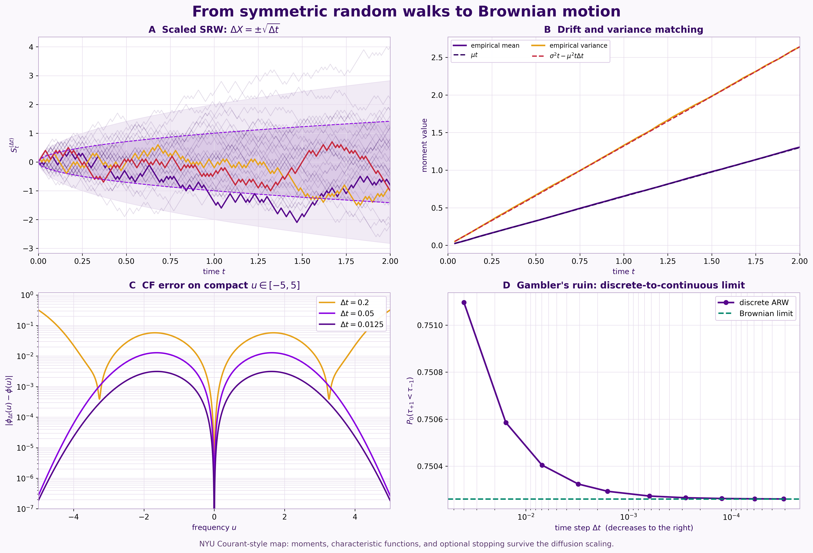
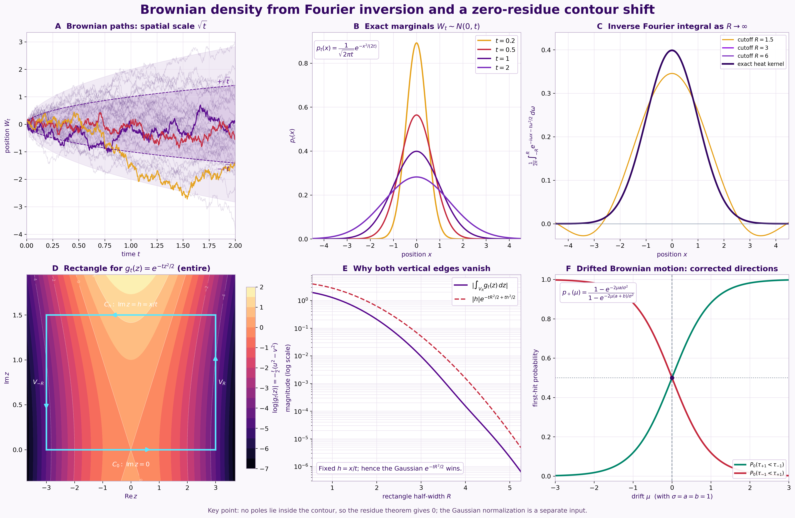
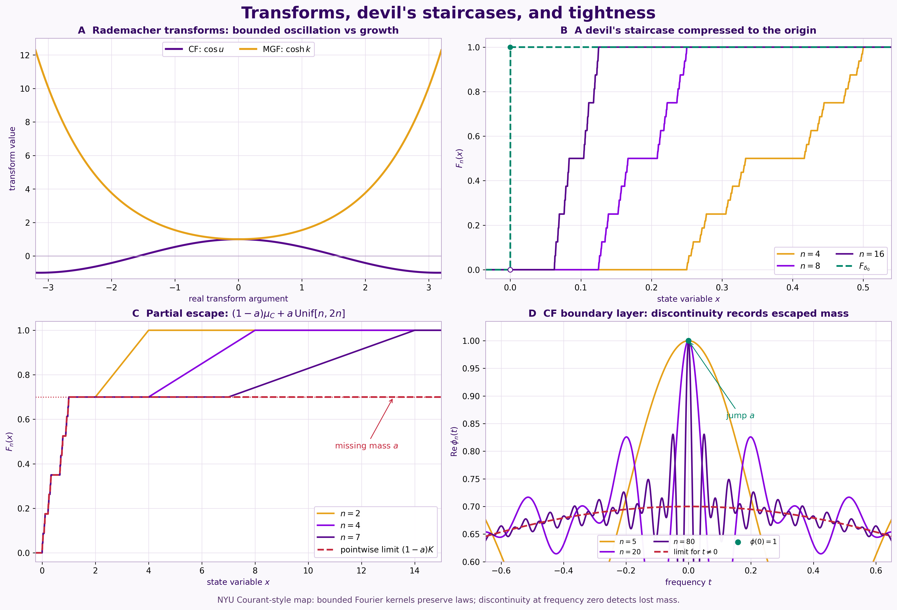
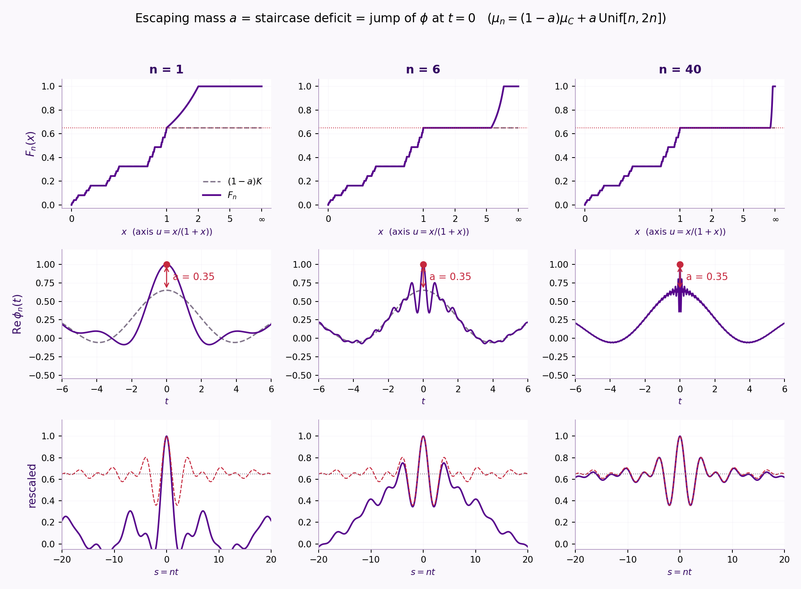
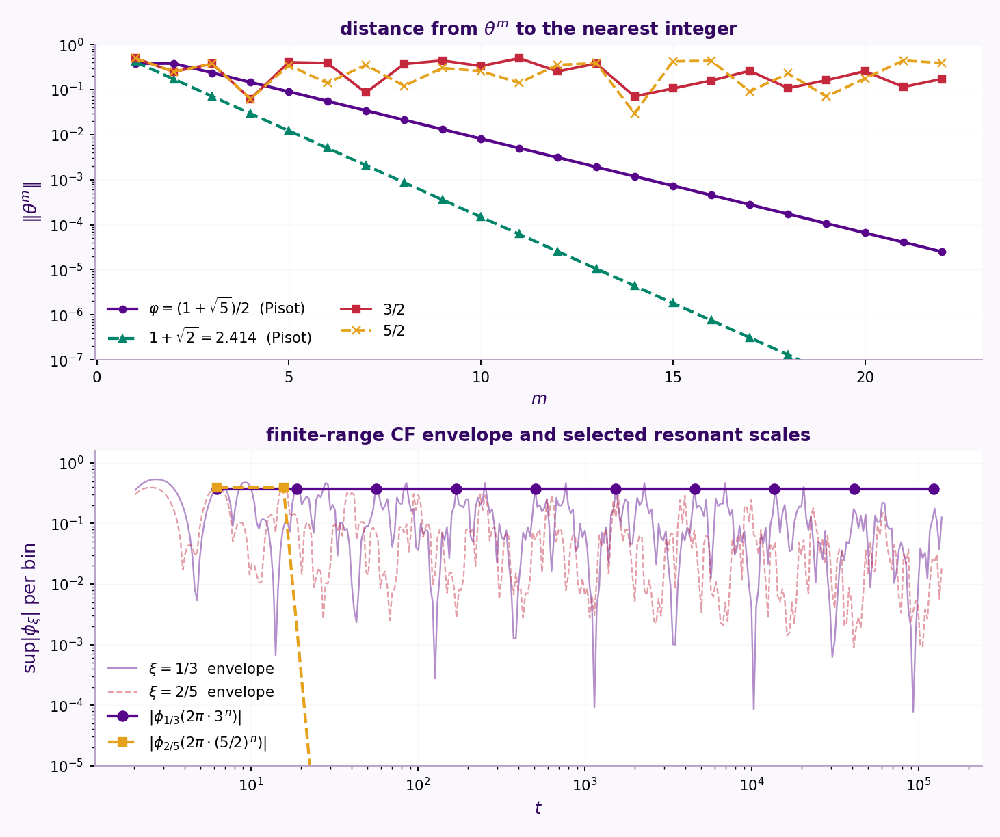

# From Random Walks to Brownian Motion

[](https://www.python.org/)
[](LICENSE)

A compact, proof-oriented set of probability notes in an NYU Courant-inspired
violet visual system.  The project follows the full discrete-to-continuous
chain

\[
\text{Rademacher variables}
\longrightarrow \text{SRW/ARW}
\longrightarrow \text{martingales and OST}
\longrightarrow \text{Lévy/Donsker}
\longrightarrow \text{Brownian motion}
\longrightarrow \text{Itô/Girsanov/Feynman--Kac}.
\]

The repository contains the A4 lecture-note PDF, its LaTeX and Markdown
sources, five reproducible scientific figures, and numerical smoke tests for
the formulas used in the visualizations.

## Read the notes

- [A4 PDF](notes/brownian_motion_notes.pdf)
- [GitHub-readable Markdown](notes/brownian_motion_notes.md)
- [LaTeX source](notes/brownian_motion_notes.tex)

## Visual map

### Random walks and diffusion scaling



### Fourier inversion and the zero-residue contour shift



### Transform convergence, tightness, and escaped mass



### Lévy boundary layer and Cantor--Pisot diagnostics

| Escaping mass | Pisot resonance |
|:--:|:--:|
|  |  |

## Mathematical coverage

- Rademacher variables; SRW expectation, variance, covariance, quadratic
  variation, and exponential martingales.
- Optional stopping and gambler's ruin; weakly biased ARW and drift matching.
- Characteristic functions versus MGFs; Lévy continuity; pointwise, uniform,
  locally uniform, in-measure, in-probability, and weak convergence.
- Cantor devil's staircases, escaped mass, tightness, Prokhorov, and
  Arzelà--Ascoli.
- Donsker's invariance principle in \(C([0,T])\), including finite-dimensional
  convergence and a fourth-moment tightness argument.
- Brownian heat kernel via Fourier inversion and an entire-function contour
  deformation; the residue sum is zero.
- Kolmogorov extension and Kolmogorov--Chentsov continuity; Wiener measure.
- The \(L^2\) Itô integral, Itô isometry, Itô formula, Girsanov change of
  measure, infinitesimal generators, Dynkin's formula, Feynman--Kac, and weak
  Fokker--Planck solutions.

## Reproduce the project

Python 3.10 or later is recommended.  From the repository root:

```bash
python3 -m venv .venv
source .venv/bin/activate
python3 -m pip install -r requirements.txt
python3 scripts/generate_all.py
python3 -m unittest discover -s tests -v
```

To compile the PDF, install a TeX distribution containing XeLaTeX and
`latexmk`, then run:

```bash
make pdf
```

To regenerate the Markdown from the canonical LaTeX source:

```bash
make markdown
```

The simulation figures use fixed random seeds.  The analytic curves are
computed directly from the formulas in the notes.

## Repository layout

```text
brownian_motion/
├── figures/                  # generated PNG figures
├── notes/
│   ├── brownian_motion_notes.md
│   ├── brownian_motion_notes.pdf
│   └── brownian_motion_notes.tex
├── scripts/
│   ├── generate_all.py       # one-command figure build
│   ├── brownian_contour.py
│   ├── levy_examples.py
│   ├── srw_convergence.py
│   └── transform_tightness.py
├── tests/test_formulas.py
├── Makefile
├── requirements.txt
└── LICENSE
```

## Numerical scope

The plots are explanatory numerical experiments, not computer-assisted
proofs.  In particular, the finite-range Bernoulli-convolution envelope only
illustrates the Pisot/Rajchman distinction; the asymptotic statement used in
the notes is analytic.

## License

Released under the [MIT License](LICENSE).


## Brownian functional and predictable compensator

The [compensator project](compensator/) contains a complete analytic solution
for the recorded nonsmooth payoff, 39 compiled Lean component theorems,
reproducible numerical experiments, and a vector proof-dependency map.
The [Lean source](compensator/Brownian_Compensator_Verified_Components.lean) and
[verification workflow](https://github.com/Eliguli712/brownian_motion/actions/workflows/brownian-compensator-lean.yml)
check the included components. The full stochastic-integral compensator theorem
remains an open Lean formalization obligation; the exact boundary is listed in
[the verification ledger](compensator/VERIFICATION.md).
