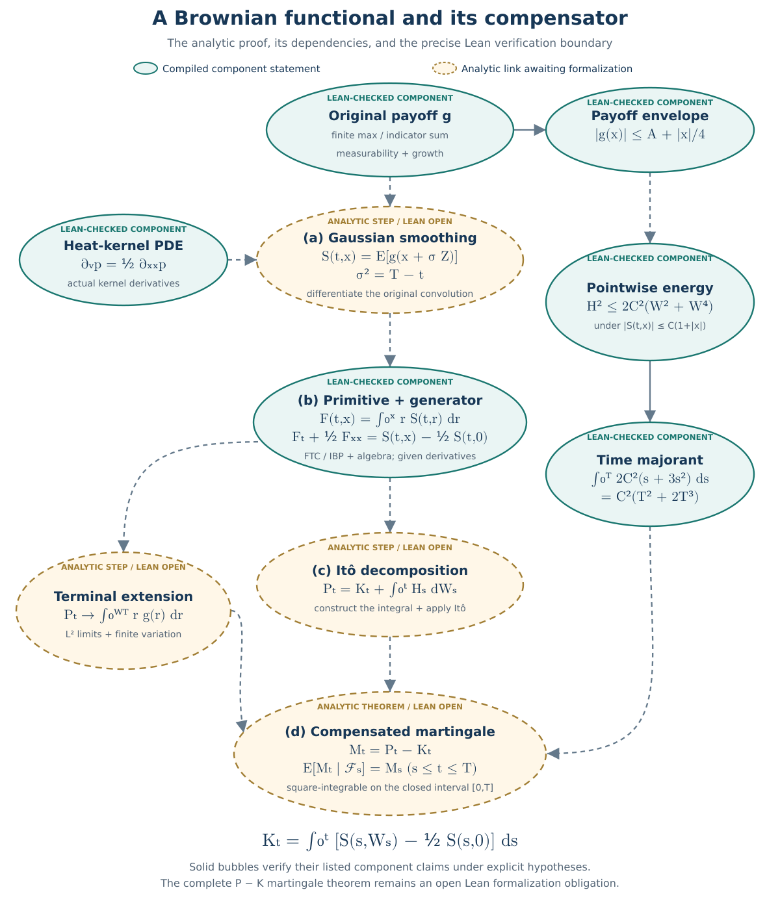

# A Brownian Functional and Its Predictable Compensator

[](https://github.com/Eliguli712/brownian_motion/actions/workflows/brownian-compensator-lean.yml)

This package treats the **Brownian functional and compensator problem** recorded
in the recovered four-page solution, parts (a)-(d). The English paper includes
the full analytic proof, the explicit original-payoff formula, terminal-time
arguments, and six reproducible numerical figures.

**Lean status:** 39 included component theorems have been compiled and axiom-audited.
The full stochastic-integral/compensator martingale theorem remains an open
formalization obligation. `VERIFICATION.md` and the paper specify the exact
coverage. The numerical experiments and quadratic test theorems have separate
roles and are labeled accordingly.

## Published paper and permanent proof links

- [English paper with vector proof map](paper.pdf).
- [Permanent Lean source](https://github.com/Eliguli712/brownian_motion/blob/73a1d2ff4f3125264fe3d2e9d1daa013fd31582e/compensator/Brownian_Compensator_Verified_Components.lean).
- [Successful verification run](https://github.com/Eliguli712/brownian_motion/actions/runs/45158953034).
- [Extracted CI compiler and axiom log](logs/github_actions_verification.log).

The paper fixes the proof version to commit `73a1d2ff4f3125264fe3d2e9d1daa013fd31582e` and includes the exact reproduction commands. The verification concerns 39 component statements; the full compensator theorem retains the open obligations in the ledger.

## Proof dependency map



Solid teal bubbles indicate compiled component statements under explicit hypotheses.
Dashed amber bubbles indicate analytic links whose full Lean formalization remains open.

## Files

- `paper.pdf` and `paper.tex`: English analytic proof and numerical study.
- `Brownian_Compensator_Verified_Components.lean`: one-file version of all 39 theorems,
  followed by their axiom-audit commands.
- `lean/`: three individually compiled modules.
- `verify.sh`: pinned-revision compiler verification.
- `logs/verification.log`: actual combined-source compiler run and axiom output.
- `data/theorem_registry.json`: exact names and original modules of all 39 theorems.
- `numerics.py`: full numerical computation and figure-generation source.
- `build_report.py`: regenerate table macros from metrics and compile the paper.
- `data/`: numerical summaries, CSV tables and 32 example paths.
- `figures/`: the editable SVG proof map and its vector PDF; `numerics.py` regenerates all six numerical PDF/PNG figure pairs embedded in the paper.
- The downloadable paper is accompanied by its LaTeX source and reproducible numerical scripts.

## Compile the Lean proof source

Install Lean using the included `lean-toolchain`, then obtain the exact Mathlib
revision. The downloaded cache is required for the imports.

```bash
git clone https://github.com/leanprover-community/mathlib4.git
git -C mathlib4 checkout fc4f59e577feb1a4956671bc04ac18aaaf8cd842
cd mathlib4
lake exe cache get Mathlib.Probability.BrownianMotion.Basic \
  Mathlib.Probability.Martingale.Basic \
  Mathlib.MeasureTheory.Integral.IntervalIntegral.IntegrationByParts \
  Mathlib.Analysis.SpecialFunctions.Integrals.Basic \
  Mathlib.Analysis.SpecialFunctions.Log.Deriv \
  Mathlib.Analysis.SpecialFunctions.ExpDeriv Mathlib.Tactic
cd ..
bash compensator/verify.sh "$PWD/mathlib4"
```

The script verifies the checkout's commit, prints the actual Lean version,
compiles the combined file with warnings treated as errors, and prints the
axioms of every included theorem. A successful run verifies these statements;
the four open obligations in the ledger remain open.

## Regenerate the numerical paper

```bash
python3 -m pip install -r requirements.txt
python3 numerics.py
python3 proof_map.py
python3 build_report.py
```

Use a working XeLaTeX or Tectonic installation and Inkscape for the SVG vector conversion. Required fonts are Latin Modern
Roman, Latin Modern Math and DejaVu Sans/Mono; figures use Matplotlib's STIX fonts.
The original numerical run used Python 3.12.14. CPU/library changes can affect
the final floating-point digits. The parameter choices and seed are explicit in
`numerics.py`.

## Provenance

The problem statement is taken from the saved solution document
`Brownian_Compensator_Full_Problem_Solutions.pdf` (29 October 2026).
The newly written sources and numerical examples extend that record. The
original PDF remains separately available under its existing identity.
