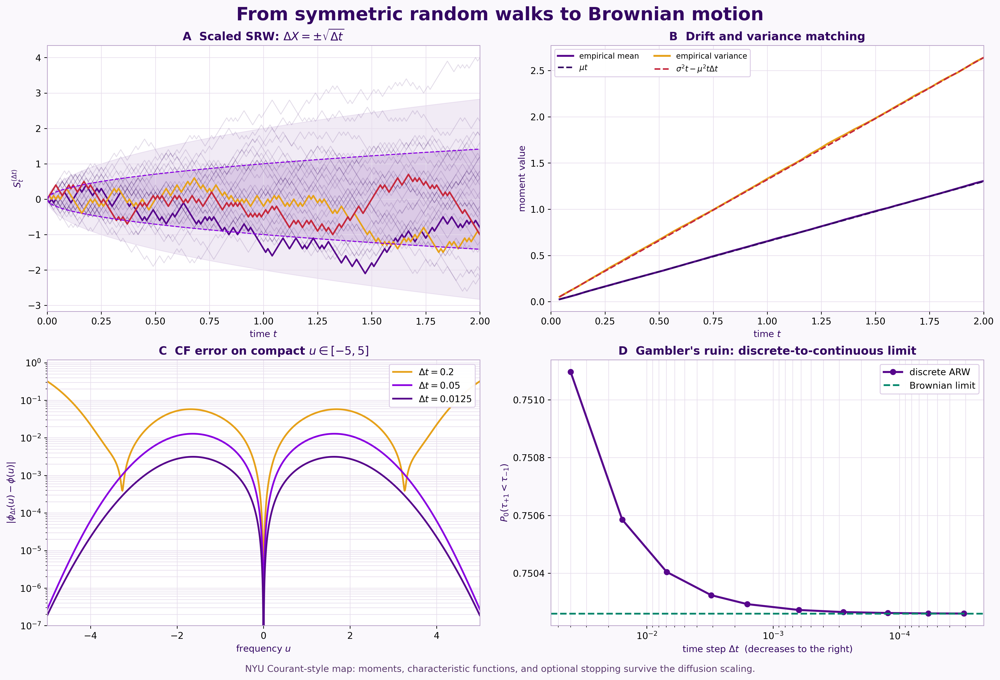
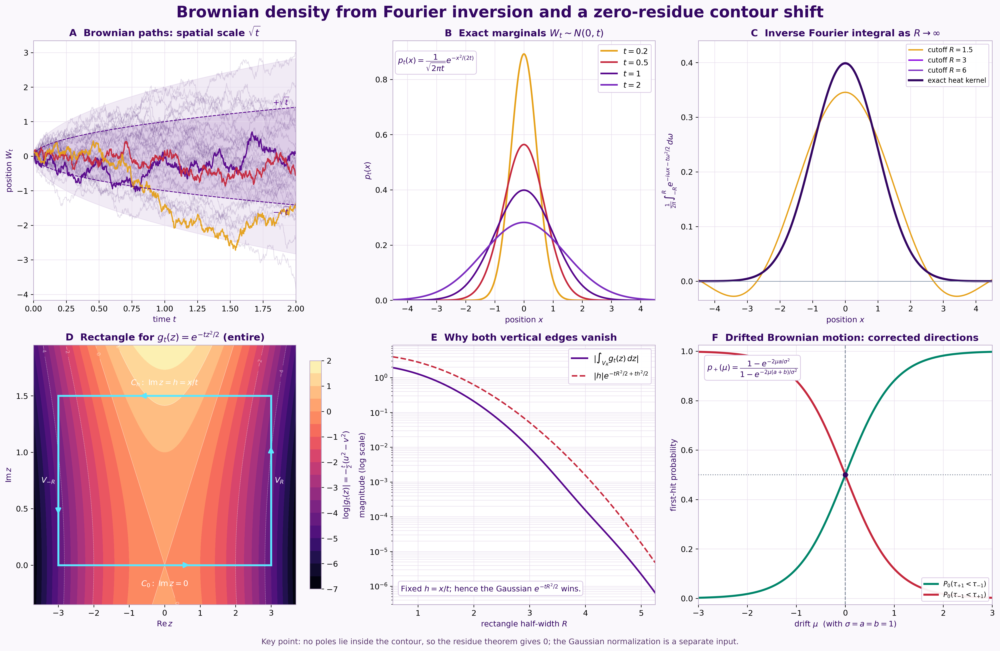
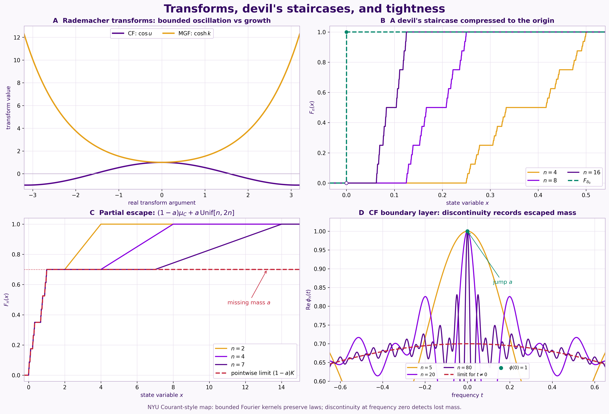
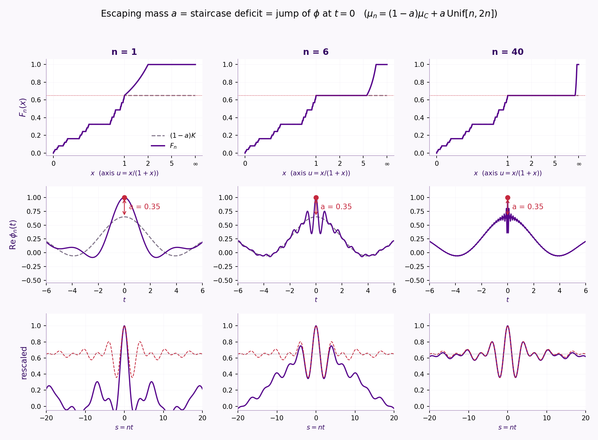
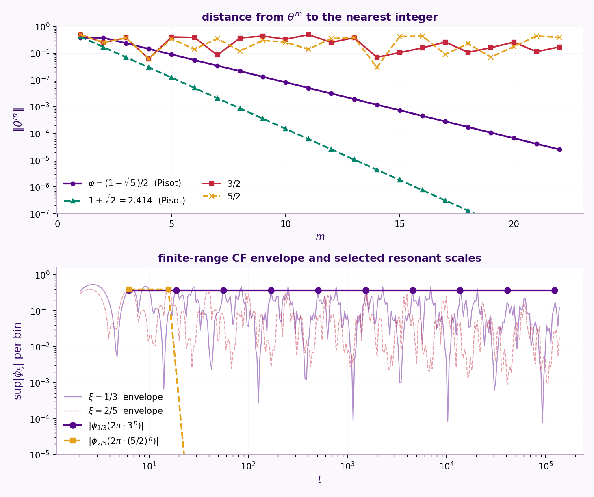

# From Random Walks to Brownian Motion

------------------------------------------------------------------------

  
**From Random Walks to  
Brownian Motion**

Martingales, Lévy Continuity, and Donsker Scaling,  
Wiener Measure, Girsanov, and PDE Methods

Formal notes in the NYU Courant visual style

For the symmetric random walk $S_n=\sum_{j=1}^n\xi_j$, $$\mathbb E[S_n]=0,\qquad \operatorname{Var}(S_n)=n,\qquad
    [S]_n=\langle S\rangle_n=n,$$ and $e^{\theta S_n}/(\cosh\theta)^n$ is a martingale. Under diffusion scaling these objects converge to their Brownian counterparts. In the drifted model $X_t=x_0+\mu t+\sigma B_t$, the cumulant rate of the exponential $e^{\theta(X_t-x_0)}$ is $$\psi(\theta)=\mu\theta+\frac12\sigma^2\theta^2.$$ Hence the compensated process $$\exp\!\left(\theta(X_t-x_0)-\psi(\theta)t\right)$$ is a mean-one martingale for every $\theta\in\mathbb R$. The uncorrected exponential is a martingale at the nontrivial calibration $\theta_*=-2\mu/\sigma^2$.

Eliguli Meowsgruntuli

September 7, 2026

------------------------------------------------------------------------

# Model, notation, and transform conventions

Let $(\Omega,\mathcal F,(\mathcal F_t)_{t\ge0},\mathbb P)$ be a filtered probability space satisfying the usual conditions, and let $(B_t)_{t\ge0}$ be standard Brownian motion. Fix constants $$x_0\in\mathbb R,\qquad \mu\in\mathbb R,\qquad \sigma>0,$$ and define the drifted, volatility-scaled process $$X_t=x_0+\mu t+\sigma B_t.
  \label{eq:model}$$ At a fixed time $t>0$, $$B_t\sim N(0,t),
  \qquad
  X_t\sim N(x_0+\mu t,\sigma^2t).$$

We use the Fourier convention $$\widehat f(\omega)=\int_{\mathbb R}e^{i\omega x}f(x)\,\mathrm dx,
  \qquad
  f(x)=\frac1{2\pi}\int_{\mathbb R}e^{-i\omega x}\widehat f(\omega)\,\mathrm d\omega.
  \label{eq:fourier-convention}$$ For a real random variable $Y$, its moment generating function and characteristic function are respectively $$M_Y(k)=\mathbb E[e^{kY}],
  \qquad
  \phi_Y(\omega)=\mathbb E[e^{i\omega Y}].$$

## Characteristic functions versus moment generating functions

Both transforms encode a probability law, but they live in different analytic regimes. The characteristic function is the Fourier–Stieltjes transform of the law: $$\phi_Y(u)=\int_{\mathbb R}e^{iux}\,\mathbb P_Y(\,\mathrm dx).$$ Since $|e^{iuY}|=1$, it exists for every real-valued random variable and every $u\in\mathbb R$. The MGF is the bilateral Laplace transform $$M_Y(k)=\int_{\mathbb R}e^{kx}\,\mathbb P_Y(\,\mathrm dx),$$ and can be infinite. Its effective domain is $$\mathcal D_Y:=\{k\in\mathbb R:M_Y(k)<\infty\}.
  \label{eq:mgf-domain}$$ Although $0\in\mathcal D_Y$ always, the phrase *the MGF exists* usually means that $M_Y$ is finite on an open interval containing zero.

| Feature    | Characteristic function $\phi_Y(u)$                                  | Moment generating function $M_Y(k)$                                       |
|:-----------|:---------------------------------------------------------------------|:--------------------------------------------------------------------------|
| Kernel     | $e^{iux}$, oscillatory and bounded in modulus by $1$                 | $e^{kx}$, a real exponential weight                                       |
| Existence  | Finite for every $u\in\mathbb R$ and every probability law           | May be infinite for every nonzero $k$, or finite only on one side of zero |
| Transform  | Fourier–Stieltjes transform of the probability measure               | Bilateral Laplace transform of the probability measure                    |
| Moments    | If $\mathbb E|Y|^m<\infty$, then $\phi_Y^{(m)}(0)=i^m\mathbb E[Y^m]$ | If finite in a neighborhood of $0$, then $M_Y^{(m)}(0)=\mathbb E[Y^m]$    |
| Uniqueness | Always determines the probability law uniquely                       | Determines the law when finite on an open interval about $0$              |
| Geometry   | Maps $Y$ to rotations on the complex unit circle                     | Exponentially amplifies one tail and suppresses the other                 |

Characteristic function and moment generating function.

Where analytic continuation is legitimate, the two transforms are related by $$M_Y(k)=\phi_Y(-ik).
  \label{eq:mgf-cf-relation}$$ This substitution is not formal license to evaluate a characteristic function at complex arguments: the expectation on the right must remain finite.

**Remark 1** (Existence and inversion qualifications). A Cauchy random variable has no finite MGF at any $k\ne0$. Positive Pareto and lognormal variables have $M_Y(k)=\infty$ for every $k>0$, so neither has an MGF on a two-sided neighborhood of zero. Their characteristic functions nevertheless exist everywhere. Also, the characteristic function always determines the law, but the elementary density inversion integral requires additional hypotheses such as $\phi_Y\in L^1(\mathbb R)$. Without a density one uses the general Fourier–Stieltjes inversion theorem for distribution functions.

**Remark 2** (Avoiding a circular derivation). If Brownian motion is defined as a Gaussian process with independent stationary increments, then $B_t\sim N(0,t)$ is part of the definition and Fourier inversion merely reconstructs the density. If one starts from the generator $\tfrac12\partial_{xx}$, the heat equation, or a continuous local martingale with quadratic variation $t$, then the characteristic function can first be derived independently and inverted afterward.

# Symmetric random walk: the discrete skeleton

## The Rademacher increment

**Definition 3** (Rademacher random variable). A random variable $R$ is Rademacher when $$\mathbb P(R=1)=\mathbb P(R=-1)=\frac12,
  \qquad
  \mathcal L(R)=\frac12\delta_{-1}+\frac12\delta_1.
  \label{eq:rademacher-law}$$

Its symmetry makes every odd moment vanish, while every even moment is one: $$\mathbb E[R^{2m+1}]=0,
  \qquad
  \mathbb E[R^{2m}]=1
  \qquad(m\ge0).$$ In particular, $$\mathbb E[R]=0,
  \qquad
  \operatorname{Var}(R)=1.$$ The two transforms display the Fourier/Laplace distinction in its simplest form: $$\begin{aligned}
  \phi_R(u)
  &=\frac{e^{iu}+e^{-iu}}2=\cos u,
  \label{eq:rademacher-cf}\\
  M_R(k)
  &=\frac{e^k+e^{-k}}2=\cosh k.
  \label{eq:rademacher-mgf}
\end{aligned}$$ Thus the CF oscillates in $[-1,1]$, whereas the MGF grows exponentially. If $A\sim\operatorname{Bernoulli}(1/2)$, then $$R=2A-1.
  \label{eq:rademacher-bernoulli}$$

For independent copies $R_1,\ldots,R_n$, the normalized sum already contains the characteristic-function proof of the central limit theorem: $$\begin{aligned}
  \phi_{n^{-1/2}\sum_{j=1}^nR_j}(u)
  &=\left(\cos\frac{u}{\sqrt n}\right)^n\\
  &=\exp\!\left[
    n\log\cos\!\left(\frac{u}{\sqrt n}\right)
  \right]
  \longrightarrow e^{-u^2/2},
  \label{eq:rademacher-clt-cf}
\end{aligned}$$ locally uniformly in $u$, because $\log\cos z=-z^2/2+O(z^4)$ near zero. Lévy’s theorem then identifies the limit as $N(0,1)$.

## Definition, expectation, variance, and covariance

Let $(\xi_j)_{j\ge1}$ be independent Rademacher random variables, and define the symmetric random walk and its natural filtration by $$S_0=0,
  \qquad
  S_n=\sum_{j=1}^n\xi_j,
  \qquad
  \mathcal F_n=\sigma(\xi_1,\ldots,\xi_n).
  \label{eq:srw-definition}$$ Since $$\mathbb E[\xi_j]=0,
  \qquad
  \mathbb E[\xi_j^2]=1,
  \qquad
  \operatorname{Var}(\xi_j)=1,$$ independence gives the exact first and second moments.

**Proposition 4** (Moments of the SRW). *For all integers $m,n\ge0$, $$\mathbb E[S_n]=0,
  \qquad
  \operatorname{Var}(S_n)=n,
  \qquad
  \operatorname{Cov}(S_m,S_n)=\min\{m,n\}.
  \label{eq:srw-moments}$$ In particular, $\mathbb E[S_n^2]=n$.*

*Proof.* Linearity gives $$\mathbb E[S_n]=\sum_{j=1}^n\mathbb E[\xi_j]=0.$$ All cross-covariances vanish, so $$\operatorname{Var}(S_n)=\sum_{j=1}^n\operatorname{Var}(\xi_j)=n.$$ If $m\le n$, write $S_n=S_m+(S_n-S_m)$. The increment $S_n-S_m$ is independent of $S_m$ and centered; hence $$\operatorname{Cov}(S_m,S_n)=\operatorname{Var}(S_m)=m.$$ Symmetry in $m,n$ yields the final formula. ◻

## Three elementary martingales

**Proposition 5** (Linear, quadratic, and exponential martingales). *For every $\theta\in\mathbb R$, the following adapted processes are martingales: $$\begin{aligned}
  S_n,
  \qquad
  S_n^2-n,
  \qquad
  Z_n(\theta):=\frac{e^{\theta S_n}}{(\cosh\theta)^n}.
  \label{eq:three-srw-martingales}
\end{aligned}$$*

*Proof.* Because $\xi_{n+1}$ is independent of $\mathcal F_n$ and centered, $$\mathbb E[S_{n+1}\mid\mathcal F_n]
  =S_n+\mathbb E[\xi_{n+1}]=S_n.$$ Likewise, $$\begin{aligned}
  \mathbb E[S_{n+1}^2-(n+1)\mid\mathcal F_n]
  &=S_n^2+2S_n\mathbb E[\xi_{n+1}]+\mathbb E[\xi_{n+1}^2]-(n+1)\\
  &=S_n^2-n.
\end{aligned}$$ Finally, $$\mathbb E[e^{\theta\xi_{n+1}}]
  =\frac{e^\theta+e^{-\theta}}2=\cosh\theta,$$ and therefore $$\mathbb E[Z_{n+1}(\theta)\mid\mathcal F_n]
  =\frac{e^{\theta S_n}}{(\cosh\theta)^{n+1}}
   \mathbb E[e^{\theta\xi_{n+1}}]
  =Z_n(\theta).$$ ◻

## Optional stopping in discrete time

**Theorem 6** (Optional stopping theorem, useful forms). *Let $(M_n,\mathcal F_n)_{n\ge0}$ be an integrable discrete-time martingale and $\tau$ a stopping time. For every deterministic $N$, $$\mathbb E[M_{\tau\wedge N}]=\mathbb E[M_0].
  \label{eq:bounded-ost}$$ If $\tau<\infty$ almost surely, moreover, $\mathbb E[M_\tau]=\mathbb E[M_0]$ follows if, for example, any one of the following holds:*

1.  *$\tau$ is almost surely bounded;*

2.  *the stopped family $\{M_{\tau\wedge N}:N\ge1\}$ is uniformly integrable;*

3.  *$\mathbb E[\tau]<\infty$ and the increments satisfy $|M_n-M_{n-1}|\le C$ almost surely for a deterministic $C$.*

*Core calculation.* For bounded stopping, $$M_{\tau\wedge N}
  =M_0+\sum_{j=1}^{N}
    (M_j-M_{j-1})\mathbf 1_{\{\tau\ge j\}}.$$ Because $\{\tau\ge j\}\in\mathcal F_{j-1}$, $$\mathbb E\!\left[
    (M_j-M_{j-1})\mathbf 1_{\{\tau\ge j\}}
  \right]
  =
  \mathbb E\!\left[
    \mathbf 1_{\{\tau\ge j\}}
    \mathbb E[M_j-M_{j-1}\mid\mathcal F_{j-1}]
  \right]=0.$$ Summation proves <a href="#eq:bounded-ost" data-reference-type="eqref" data-reference="eq:bounded-ost">[eq:bounded-ost]</a>. Each additional hypothesis gives the integrability needed to pass from $\tau\wedge N$ to $\tau$. ◻

The facts that $M$ is a martingale and $\tau<\infty$ almost surely do not alone justify $\mathbb E[M_\tau]=\mathbb E[M_0]$. The theorem is a limit passage, and boundedness, uniform integrability, or an equivalent domination condition is what prevents expectation from being lost at large stopping times.

## Optional and predictable quadratic variation

For a discrete local martingale $M$, distinguish the realized quadratic variation $$_n:=\sum_{j=1}^n(\Delta M_j)^2
  \label{eq:optional-qv}$$ from the predictable bracket $$\langle M\rangle_n
  :=\sum_{j=1}^n\mathbb E[(\Delta M_j)^2\mid\mathcal F_{j-1}].
  \label{eq:predictable-qv}$$ For the SRW, $\Delta S_j=\xi_j$ and $\xi_j^2=1$ deterministically, so $$\boxed{[S]_n=\langle S\rangle_n=n.}
  \label{eq:srw-qv}$$ For SRW the two quantities coincide numerically. Modern notation nevertheless reserves the realized square sum for $[M]_n$; for a general martingale, $[M]_n$ and $\langle M\rangle_n$ need not coincide.

## Diffusion scaling and weak drift bias

Let $\delta=\Delta t>0$ and choose the spatial step $$h=\Delta x=\sigma\sqrt\delta.
  \label{eq:diffusion-scaling}$$ For a weakly biased walk, define one-step increments by $$\Delta X_j^\delta=
  \begin{cases}
    +h,&\text{with probability }p_\delta,\\
    -h,&\text{with probability }q_\delta=1-p_\delta.
  \end{cases}$$ Matching the desired drift $\mathbb E[\Delta X_j^\delta]=\mu\delta$ gives $$\begin{aligned}
  (2p_\delta-1)\sigma\sqrt\delta&=\mu\delta,\\
  \boxed{
  p_\delta=\frac12\left(1+\frac\mu\sigma\sqrt\delta\right),
  \qquad
  q_\delta=\frac12\left(1-\frac\mu\sigma\sqrt\delta\right).
  }
  \label{eq:weak-bias}
\end{aligned}$$ The factor $1/2$ is simply the solution of the linear equation $2p_\delta-1=(\mu/\sigma)\sqrt\delta$: the bias is added around the symmetric baseline $1/2$. One must take $\delta$ small enough that $|\mu|\sqrt\delta\le\sigma$, ensuring $p_\delta,q_\delta\in[0,1]$.

For $N=t/\delta\in\mathbb N$, let $$X_t^\delta=\sum_{j=1}^{N}\Delta X_j^\delta.$$ The one-step and accumulated moments are $$\begin{aligned}
  \mathbb E[\Delta X_j^\delta]&=\mu\delta,\\
  \operatorname{Var}(\Delta X_j^\delta)
  &=\mathbb E[(\Delta X_j^\delta)^2]-\mu^2\delta^2
    =\sigma^2\delta-\mu^2\delta^2,\\
  \mathbb E[X_t^\delta]&=\mu t,\\
  \operatorname{Var}(X_t^\delta)&=\sigma^2t-\mu^2t\delta
    \longrightarrow\sigma^2t.
  \label{eq:arw-moments}
\end{aligned}$$ Moreover, the realized square sum is deterministic: $$\sum_{j=1}^{N}(\Delta X_j^\delta)^2
  =N\sigma^2\delta=\sigma^2t.
  \label{eq:scaled-qv}$$ With $N=\lfloor t/\delta\rfloor$, the discrepancy is at most $\sigma^2\delta$. Hence this quadratic-variation clock converges uniformly on compact time intervals to $\sigma^2t$. This is an exact structural match; by itself it does not prove process-level convergence.

## Discrete exponential calibration and its continuous limit

For scaled symmetric increments $\pm\sigma\sqrt\delta$, define $$Z_t^\delta(\theta)
  =\frac{\exp(\theta X_t^\delta)}
  {\bigl(\cosh(\theta\sigma\sqrt\delta)\bigr)^{t/\delta}}.
  \label{eq:scaled-exponential-martingale}$$ At lattice times this is a martingale. Since $$\log\cosh y=\frac{y^2}{2}+O(y^4),$$ we obtain $$\frac{t}{\delta}\log\cosh(\theta\sigma\sqrt\delta)
  =\frac12\theta^2\sigma^2t+O(t\delta).
  \label{eq:cosh-limit}$$ Thus the denominator converges to $e^{\theta^2\sigma^2t/2}$, and the limiting stochastic exponential is $$\exp\!\left(\theta\sigma B_t-\frac12\theta^2\sigma^2t\right).
  \label{eq:srw-bm-exponential-limit}$$

For the biased probabilities <a href="#eq:weak-bias" data-reference-type="eqref" data-reference="eq:weak-bias">[eq:weak-bias]</a>, the one-step MGF is $$\begin{aligned}
  m_\delta(\theta)
  &=p_\delta e^{\theta\sigma\sqrt\delta}
    +q_\delta e^{-\theta\sigma\sqrt\delta}\\
  &=1+\left(\mu\theta+\frac12\sigma^2\theta^2\right)\delta
    +O(\delta^2),
  \label{eq:biased-step-mgf}
\end{aligned}$$ locally uniformly in $\theta$. Consequently, $$m_\delta(\theta)^{t/\delta}
  \longrightarrow
  \exp\!\left[
    \left(\mu\theta+\frac12\sigma^2\theta^2\right)t
  \right],
  \label{eq:biased-mgf-limit}$$ which is precisely the compensator appearing in the continuous exponential martingale.

## Gambler’s ruin and the Brownian exit formula

Let an integer-valued biased walk start at zero and stop on first hitting $-a$ or $+b$, where $a,b\in\mathbb N$. With $r=q/p$, the upper-hit probability is $$\mathbb P_0(\tau_b<\tau_{-a})
  =
  \begin{cases}
  \dfrac{1-r^a}{1-r^{a+b}},&p\ne q,\\[2mm]
  \dfrac{a}{a+b},&p=q=\frac12.
  \end{cases}
  \label{eq:discrete-gambler-ruin}$$ The denominator $1-r^{a+b}$ is essential for boundaries $-a$ and $+b$; the expression $r^b-r^a$ corresponds to a different coordinate convention and cannot be inserted without translating the starting point and boundaries.

*Martingale/OST derivation of <a href="#eq:discrete-gambler-ruin" data-reference-type="eqref" data-reference="eq:discrete-gambler-ruin">[eq:discrete-gambler-ruin]</a>.* Let $Y_n$ be the walk and $\tau=\inf\{n\ge0:Y_n\in\{-a,b\}\}$. When $p\ne q$, put $r=q/p$. Since $$\mathbb E[r^{Y_{n+1}}\mid\mathcal F_n]
  =r^{Y_n}\bigl(pr+qr^{-1}\bigr)
  =r^{Y_n},$$ the process $r^{Y_n}$ is a martingale. Before and at exit, $Y_{\tau\wedge n}\in[-a,b]$, so the stopped family is bounded. Theorem <a href="#thm:discrete-ost" data-reference-type="ref" data-reference="thm:discrete-ost">6</a> gives, with $\pi=\mathbb P_0(Y_\tau=b)$, $$1=\mathbb E[r^{Y_\tau}]
   =\pi r^b+(1-\pi)r^{-a}.$$ Solving yields $$\pi=\frac{1-r^a}{1-r^{a+b}}.$$ When $p=q=1/2$, apply OST to $Y_n$ itself: $$0=\mathbb E[Y_\tau]=\pi b-(1-\pi)a,$$ and hence $\pi=a/(a+b)$. ◻

The quadratic martingale gives more than the hitting side. In the symmetric case, bounded stopping applied to $Y_n^2-n$ gives $$\mathbb E[\tau\wedge N]
  =\mathbb E[Y_{\tau\wedge N}^2]
  \le\max\{a^2,b^2\}.$$ Monotone convergence first proves $\mathbb E[\tau]<\infty$; bounded convergence for $Y_{\tau\wedge N}^2$ then yields $$\begin{aligned}
  0
  &=\mathbb E[Y_\tau^2-\tau]
   =\pi b^2+(1-\pi)a^2-\mathbb E[\tau],\\
  \boxed{\mathbb E_0[\tau]=ab.}
  \label{eq:fair-ruin-duration}
\end{aligned}$$ Thus the same Rademacher increment produces both the harmonic exit probability and the mean absorption time.

To hold physical barriers $-A$ and $+B$ fixed, take $$a=\frac{A}{\sigma\sqrt\delta},
  \qquad
  b=\frac{B}{\sigma\sqrt\delta},$$ along a lattice-compatible sequence. Writing $\varepsilon=(\mu/\sigma)\sqrt\delta$, $$\log\frac{q_\delta}{p_\delta}
  =\log\frac{1-\varepsilon}{1+\varepsilon}
  =-2\varepsilon+O(\varepsilon^3).
  \label{eq:ratio-expansion}$$ Hence $$\left(\frac{q_\delta}{p_\delta}\right)^a
  \longrightarrow e^{-2\mu A/\sigma^2},
  \qquad
  \left(\frac{q_\delta}{p_\delta}\right)^{a+b}
  \longrightarrow e^{-2\mu(A+B)/\sigma^2}.
  \label{eq:ratio-power-limit}$$ Substitution in <a href="#eq:discrete-gambler-ruin" data-reference-type="eqref" data-reference="eq:discrete-gambler-ruin">[eq:discrete-gambler-ruin]</a> gives the drifted Brownian exit formula derived again in Section <a href="#sec:brownian-exit" data-reference-type="ref" data-reference="sec:brownian-exit">6</a> by optional stopping.

# Gaussian MGF and the substitution $k=\theta\sigma$

## Direct completion-of-the-square calculation

**Proposition 7** (MGF of a Brownian marginal). *For every $t>0$ and $k\in\mathbb R$, $$\mathbb E[e^{kB_t}]=e^{k^2t/2}.
  \label{eq:brownian-mgf}$$*

*Proof.* The density of $B_t$ is $$p_t(x)=\frac1{\sqrt{2\pi t}}
  \exp\!\left(-\frac{x^2}{2t}\right).$$ Therefore $$\begin{aligned}
  \mathbb E[e^{kB_t}]
  &=\frac1{\sqrt{2\pi t}}
    \int_{\mathbb R}\exp\!\left(kx-\frac{x^2}{2t}\right)\,\mathrm dx.\label{eq:mgf-integral}
\end{aligned}$$ Complete the square: $$\begin{aligned}
  kx-\frac{x^2}{2t}
  &=-\frac1{2t}(x^2-2tkx)\\
  &=-\frac{(x-tk)^2}{2t}+\frac{k^2t}{2}.
  \label{eq:mgf-square}
\end{aligned}$$ Substituting <a href="#eq:mgf-square" data-reference-type="eqref" data-reference="eq:mgf-square">[eq:mgf-square]</a> into <a href="#eq:mgf-integral" data-reference-type="eqref" data-reference="eq:mgf-integral">[eq:mgf-integral]</a> gives $$\begin{aligned}
  \mathbb E[e^{kB_t}]
  &=e^{k^2t/2}
    \int_{\mathbb R}\frac1{\sqrt{2\pi t}}
      \exp\!\left(-\frac{(x-tk)^2}{2t}\right)\,\mathrm dx\\
  &=e^{k^2t/2}.
\end{aligned}$$ The remaining integrand is the density of $N(tk,t)$, so its integral is one. ◻

**Corollary 8** (General normal MGF). *If $Y\sim N(m,v)$, where $v\ge0$, then $$M_Y(k)=\mathbb E[e^{kY}]=\exp\!\left(mk+\frac12vk^2\right).
  \label{eq:normal-mgf}$$ In particular, $m=0$ and $v=t$ recover <a href="#eq:brownian-mgf" data-reference-type="eqref" data-reference="eq:brownian-mgf">[eq:brownian-mgf]</a>.*

## Why introduce $k=\theta\sigma$?

Insert <a href="#eq:model" data-reference-type="eqref" data-reference="eq:model">[eq:model]</a> into the exponential: $$\begin{aligned}
  e^{\theta X_t}
  &=e^{\theta x_0}e^{\theta\mu t}e^{(\theta\sigma)B_t},\\
  \mathbb E[e^{\theta X_t}]
  &=e^{\theta x_0}e^{\theta\mu t}
    \mathbb E[e^{(\theta\sigma)B_t}].
  \label{eq:separate-drift-noise}
\end{aligned}$$ The standard MGF formula is written for an exponent $kB_t$. The actual coefficient multiplying $B_t$ in <a href="#eq:separate-drift-noise" data-reference-type="eqref" data-reference="eq:separate-drift-noise">[eq:separate-drift-noise]</a> is $\theta\sigma$. Thus $$\boxed{k=\theta\sigma}
  \label{eq:k-substitution}$$ is exactly the coefficient-matching substitution needed to invoke <a href="#eq:brownian-mgf" data-reference-type="eqref" data-reference="eq:brownian-mgf">[eq:brownian-mgf]</a>. It is an abbreviation, not a new probabilistic assumption and not a change of measure.

Using <a href="#eq:brownian-mgf" data-reference-type="eqref" data-reference="eq:brownian-mgf">[eq:brownian-mgf]</a>, $$\begin{aligned}
  \mathbb E[e^{\theta X_t}]
  &=e^{\theta x_0}e^{\theta\mu t}
    e^{(\theta\sigma)^2t/2}\\
  &=\exp\!\left[
      \theta x_0+\left(\mu\theta+\frac12\sigma^2\theta^2\right)t
    \right].
  \label{eq:X-mgf}
\end{aligned}$$

The volatility $\sigma$ rescales the random noise before the exponential is taken. After coefficient matching, the Gaussian MGF turns this random term into the deterministic growth contribution $$\frac12(\theta\sigma)^2t=\frac12\theta^2\sigma^2t.$$ This is the exact contribution that must be balanced against the drift term $\mu\theta t$.

# Exponential-martingale calibration

Define the cumulant rate $$\psi(\theta):=\mu\theta+\frac12\sigma^2\theta^2.
  \label{eq:cumulant-rate}$$

**Theorem 9** (Compensated exponential martingale). *For every $\theta\in\mathbb R$, the process $$\mathcal E_t(\theta)
  :=\exp\!\left(
       \theta(X_t-x_0)-\psi(\theta)t
     \right)
  \label{eq:compensated-martingale}$$ is a positive, mean-one $(\mathcal F_t)$-martingale.*

*Proof.* Let $0\le s\le t$. From independent Brownian increments, $B_t-B_s\sim N(0,t-s)$ and is independent of $\mathcal F_s$. Dividing $\mathcal E_t(\theta)$ by $\mathcal E_s(\theta)$ yields $$\frac{\mathcal E_t(\theta)}{\mathcal E_s(\theta)}
  =\exp\!\left(
      \theta\sigma(B_t-B_s)
      -\frac12\theta^2\sigma^2(t-s)
    \right).$$ Conditional expectation and <a href="#eq:brownian-mgf" data-reference-type="eqref" data-reference="eq:brownian-mgf">[eq:brownian-mgf]</a> give $$\begin{aligned}
  \mathbb E[\mathcal E_t(\theta)\mid\mathcal F_s]
  &=\mathcal E_s(\theta)
    e^{-\theta^2\sigma^2(t-s)/2}
    \mathbb E[e^{\theta\sigma(B_t-B_s)}]\\
  &=\mathcal E_s(\theta).
\end{aligned}$$ Since $\mathcal E_0(\theta)=1$, its expectation is one at every time. ◻

**Corollary 10** (Uncorrected calibration). *The process $e^{\theta(X_t-x_0)}$ is a martingale precisely when $$\psi(\theta)=0.
  \label{eq:balance-equation}$$ The two roots are $$\theta=0
  \qquad\text{and}\qquad
  \boxed{\theta_*=-\frac{2\mu}{\sigma^2}}.
  \label{eq:theta-star}$$ For $x_0=0$, the nontrivial process $e^{\theta_*X_t}$ is mean one. For general $x_0$, the mean-one normalization is $e^{\theta_*(X_t-x_0)}$.*

*Proof.* Ito’s formula provides a local differential verification: $$\,\mathrm de^{\theta(X_t-x_0)}
  =e^{\theta(X_t-x_0)}
   \left[
     \theta\sigma\,\mathrm dB_t
     +\left(\mu\theta+\frac12\sigma^2\theta^2\right)\,\mathrm dt
   \right].
  \label{eq:ito-exponential}$$ The finite-variation term vanishes exactly when <a href="#eq:balance-equation" data-reference-type="eqref" data-reference="eq:balance-equation">[eq:balance-equation]</a> holds. The conditional-expectation argument above then upgrades the resulting local martingale to a true martingale. ◻

**Remark 11** (Mean one is not, by itself, a martingale proof). For an arbitrary adapted process, the condition $\mathbb E[M_t]=1$ for every $t$ does not imply $\mathbb E[M_t\mid\mathcal F_s]=M_s$. Here the martingale property follows from independent increments, or equivalently from the stochastic-exponential argument; the constant expectation is a consequence.

# Characteristic function and Brownian transition density

The Gaussian MGF is finite for every real argument and extends to complex arguments. Setting $k=i\omega$ in <a href="#eq:brownian-mgf" data-reference-type="eqref" data-reference="eq:brownian-mgf">[eq:brownian-mgf]</a> gives $$\phi_{B_t}(\omega)=\mathbb E[e^{i\omega B_t}]
  =e^{-t\omega^2/2}.
  \label{eq:brownian-cf}$$ For the drifted process, $$\phi_{X_t}(\omega)
  =\exp\!\left(
      i\omega(x_0+\mu t)-\frac12\sigma^2t\omega^2
    \right).
  \label{eq:X-cf}$$

## Fourier inversion

For standard Brownian motion, <a href="#eq:fourier-convention" data-reference-type="eqref" data-reference="eq:fourier-convention">[eq:fourier-convention]</a> and <a href="#eq:brownian-cf" data-reference-type="eqref" data-reference="eq:brownian-cf">[eq:brownian-cf]</a> give $$p_t(x)=\frac1{2\pi}I_t(x),
  \qquad
  I_t(x)=\int_{\mathbb R}e^{-t\omega^2/2-i x\omega}\,\mathrm d\omega.
  \label{eq:inverse-fourier}$$ Complete the square: $$-\frac t2\omega^2-i x\omega
  =-\frac t2\left(\omega+\frac{i x}{t}\right)^2
   -\frac{x^2}{2t}.
  \label{eq:fourier-square}$$ Thus $$I_t(x)=e^{-x^2/(2t)}
  \int_{\mathbb R}e^{-\frac t2(\omega+i x/t)^2}\,\mathrm d\omega.
  \label{eq:shifted-integral}$$

## The entire-function contour shift

**Lemma 12** (Horizontal contour-shift identity). *For every $t>0$ and every $h\in\mathbb R$, $$\int_{\mathbb R}e^{-t(u+ih)^2/2}\,\mathrm du
  =\int_{\mathbb R}e^{-tu^2/2}\,\mathrm du.
  \label{eq:contour-shift}$$*

*Proof.* Let $g_t(z)=e^{-tz^2/2}$, which is entire. First assume $h>0$ and use the counterclockwise rectangle with vertices $-R,R,R+ih,-R+ih$. The residue theorem gives $$\oint_{\Gamma_R}g_t(z)\,\mathrm dz
  =2\pi i\sum_{z_k\in\operatorname{int}\Gamma_R}\operatorname{Res}(g_t;z_k)=0,
  \label{eq:zero-residue}$$ because there are no singularities.

On the right edge $z=R+iy$, $0\le y\le h$, $$|g_t(R+iy)|
  =\exp\!\left[-\frac t2(R^2-y^2)\right]
  \le \exp\!\left(-\frac{tR^2}{2}+\frac{th^2}{2}\right).$$ The ML estimate therefore gives $$\left|\int_{V_R}g_t(z)\,\mathrm dz\right|
  \le h\exp\!\left(-\frac{tR^2}{2}+\frac{th^2}{2}\right)
  \longrightarrow0.
  \label{eq:vertical-bound}$$ The left edge obeys the same bound. Letting $R\to\infty$ in <a href="#eq:zero-residue" data-reference-type="eqref" data-reference="eq:zero-residue">[eq:zero-residue]</a> leaves the bottom and oppositely oriented top edges, which proves <a href="#eq:contour-shift" data-reference-type="eqref" data-reference="eq:contour-shift">[eq:contour-shift]</a>. For $h<0$, use the rectangle below the real axis and replace $h$ by $|h|$ in the estimate. The case $h=0$ is immediate. ◻

**Remark 13** (What the residue theorem does and does not compute). The contour argument is valid, but all residues are zero. Its purpose is to justify moving the line of integration from $\operatorname{Im}z=0$ to $\operatorname{Im}z=x/t$. It does not determine the Gaussian normalization constant. Also, $$|e^{-tz^2/2}|=e^{-t((\operatorname{Re}z)^2-(\operatorname{Im}z)^2)/2},$$ so the integrand grows along the imaginary axis. The vertical-edge argument works because the height $|h|$ is fixed while $R\to\infty$.

## Gaussian normalization and the heat kernel

**Proposition 14** (Gaussian integral). *For $t>0$, $$\int_{\mathbb R}e^{-tu^2/2}\,\mathrm du=\sqrt{\frac{2\pi}{t}}.
  \label{eq:gaussian-integral}$$*

*Proof.* Scaling reduces the problem to $G=\int_{\mathbb R}e^{-u^2/2}\,\mathrm du$. By Tonelli’s theorem and polar coordinates, $$G^2=\iint_{\mathbb R^2}e^{-(u^2+v^2)/2}\,\mathrm du\,\mathrm dv
  =\int_0^{2\pi}\int_0^\infty e^{-r^2/2}r\,\mathrm dr\,\mathrm d\varphi
  =2\pi.$$ Since $G>0$, $G=\sqrt{2\pi}$, and rescaling gives <a href="#eq:gaussian-integral" data-reference-type="eqref" data-reference="eq:gaussian-integral">[eq:gaussian-integral]</a>. ◻

Taking $h=x/t$ in <a href="#eq:contour-shift" data-reference-type="eqref" data-reference="eq:contour-shift">[eq:contour-shift]</a>, then using <a href="#eq:shifted-integral" data-reference-type="eqref" data-reference="eq:shifted-integral">[eq:shifted-integral]</a> and <a href="#eq:gaussian-integral" data-reference-type="eqref" data-reference="eq:gaussian-integral">[eq:gaussian-integral]</a>, gives $$I_t(x)=e^{-x^2/(2t)}\sqrt{\frac{2\pi}{t}}.$$ Consequently,

**Theorem 15** (Brownian heat kernel). *For each fixed $t>0$, the exact marginal density of $B_t$ is $$\boxed{
  p_t(x)=\frac1{\sqrt{2\pi t}}
  \exp\!\left(-\frac{x^2}{2t}\right)
  }.
  \label{eq:heat-kernel}$$ It satisfies $$\partial_t p_t=\frac12\partial_{xx}p_t,
  \qquad
  \int_{\mathbb R}p_t(x)\,\mathrm dx=1,
  \qquad
  p_t\longrightarrow\delta_0\quad(t\downarrow0)$$ in the distributional sense.*

For $X_t=x_0+\mu t+\sigma B_t$, the corresponding density is $$p_X(x,t)=\frac1{\sigma\sqrt{2\pi t}}
  \exp\!\left[-\frac{(x-x_0-\mu t)^2}{2\sigma^2t}\right],
  \label{eq:drifted-density}$$ and its forward equation is $$\partial_t p=-\mu\partial_xp+\frac{\sigma^2}{2}\partial_{xx}p.$$

# Two-sided absorption via optional stopping

Assume $X_0=0$, fix $a,b>0$, and define $$\tau=\inf\{t\ge0:X_t\notin(-a,b)\}.
  \label{eq:exit-time}$$ Continuity implies $X_\tau\in\{-a,b\}$, and exit from a bounded interval occurs almost surely.

**Theorem 16** (Upper-boundary hitting probability). *Let $$p_+(\mu)=\mathbb P_0(X_\tau=b).$$ For $\mu\ne0$, $$\boxed{
  p_+(\mu)
  =\frac{1-e^{-2\mu a/\sigma^2}}
         {1-e^{-2\mu(a+b)/\sigma^2}}
  }.
  \label{eq:hitting-probability}$$ At $\mu=0$, its continuous extension is $$p_+(0)=\frac{a}{a+b}.
  \label{eq:fair-hitting}$$*

*Proof.* Suppose $\mu\ne0$ and set $\theta_*=-2\mu/\sigma^2$. Then $Y_t=e^{\theta_*X_t}$ is a martingale. Because $X_{t\wedge\tau}\in[-a,b]$, the stopped family $Y_{t\wedge\tau}$ is bounded and hence uniformly integrable. Optional stopping followed by $t\to\infty$ gives $$\begin{aligned}
  1
  &=\mathbb E[e^{\theta_*X_\tau}]\\
  &=p_+(\mu)e^{\theta_*b}
    +(1-p_+(\mu))e^{-\theta_*a}.
\end{aligned}$$ Solving for $p_+(\mu)$ and substituting $\theta_*$ yields <a href="#eq:hitting-probability" data-reference-type="eqref" data-reference="eq:hitting-probability">[eq:hitting-probability]</a>. If $\mu=0$, apply optional stopping directly to the martingale $X_t=\sigma B_t$: $$0=\mathbb E[X_\tau]=p_+(0)b-(1-p_+(0))a,$$ which gives <a href="#eq:fair-hitting" data-reference-type="eqref" data-reference="eq:fair-hitting">[eq:fair-hitting]</a>. ◻

Thus positive drift increases the probability of reaching $+b$ first, while negative drift increases the probability of reaching $-a$ first. For $a=b$, both probabilities equal $1/2$ at $\mu=0$. Any plot showing the opposite monotonic directions has either exchanged the curve labels or reversed the sign convention for drift.

# Python visualizations of the discrete–continuous limit

Figure <a href="#fig:srw-convergence" data-reference-type="ref" data-reference="fig:srw-convergence">1</a> begins with the random-walk skeleton. Every panel uses exact formulas or simulations from the definitions above; the purple palette is anchored at NYU Violet $\#57068C$.

<figure id="fig:srw-convergence">

<figcaption>Diffusion scaling of SRW. The panels show scaled sample paths, the exact first two moments, locally uniform characteristic-function convergence on a fixed compact frequency interval, and convergence of discrete gambler’s-ruin probabilities to the Brownian exit formula.</figcaption>
</figure>

| Panel | Object                   | Reading rule                                                                                     |
|:-----:|:-------------------------|:-------------------------------------------------------------------------------------------------|
|   A   | Scaled paths             | The spatial scale $\sigma\sqrt\delta$ produces fluctuations of order $\sqrt t$.                  |
|   B   | First two moments        | The weak bias preserves $\mathbb EX_t=\mu t$ and sends $\operatorname{Var}(X_t)$ to $\sigma^2t$. |
|   C   | Characteristic functions | On every fixed frequency window, the discrete CF approaches the Gaussian CF uniformly.           |
|   D   | Ruin probability         | The exact lattice exit law approaches the drifted Brownian exit formula.                         |

## Brownian, Fourier, and contour geometry

Figure <a href="#fig:six-panel" data-reference-type="ref" data-reference="fig:six-panel">2</a> continues the same argument after the limiting Brownian process has been identified.

<figure id="fig:six-panel">

<figcaption>Brownian diffusion, Fourier inversion, the zero-residue contour shift, vertical-edge decay, and correctly oriented two-sided hitting probabilities for <em>a</em> = <em>b</em> = <em>σ</em> = 1.</figcaption>
</figure>

| Panel | Object             | Reading rule                                                                                                                                                                |
|:-----:|:-------------------|:----------------------------------------------------------------------------------------------------------------------------------------------------------------------------|
|   A   | Sample paths       | Typical displacement has order $\sqrt t$.                                                                                                                                   |
|   B   | Heat kernels       | At fixed time, $B_t\sim N(0,t)$.                                                                                                                                            |
|   C   | Fourier cutoff     | Truncated inversion converges to the heat kernel.                                                                                                                           |
|   D   | Rectangle          | Shift the real axis to $\operatorname{Im}z=x/t$.                                                                                                                            |
|   E   | Vertical edges     | The Gaussian estimate <a href="#eq:vertical-bound" data-reference-type="eqref" data-reference="eq:vertical-bound">[eq:vertical-bound]</a> makes both side integrals vanish. |
|   F   | Exit probabilities | Positive drift raises the probability of first hitting the upper barrier.                                                                                                   |

## Transforms, devil’s staircases, and tightness

Figure <a href="#fig:transform-tightness" data-reference-type="ref" data-reference="fig:transform-tightness">3</a> separates a CDF jump caused by an atom from a characteristic-function discontinuity caused by escaped mass.

<figure id="fig:transform-tightness">

<figcaption>Rademacher CF versus MGF; Cantor staircases compressed toward <em>δ</em>0; a Cantor component mixed with mass escaping through [<em>n</em>,2<em>n</em>]; and the shrinking frequency boundary layer whose limiting jump at zero equals the escaped mass.</figcaption>
</figure>

| Panel | Object                   | Diagnostic meaning                                                                     |
|:-----:|:-------------------------|:---------------------------------------------------------------------------------------|
|   A   | CF versus MGF            | Oscillation keeps the CF bounded; real exponential weighting can make the MGF diverge. |
|   B   | Compressed Cantor CDFs   | Weak convergence need not hold at an atom of the limiting CDF.                         |
|   C   | Escaping mixture         | A fixed proportion of probability mass leaves every compact state-space set.           |
|   D   | Frequency boundary layer | The limiting CF jump at zero records exactly the escaped mass.                         |

# Modes of convergence

## Pointwise, uniform, almost-everywhere, and in-measure convergence

Let $(E,\mathcal A,\nu)$ be a measure space and let $f_n,f:E\to\mathbb R$ be measurable.

**Definition 17** (Pointwise convergence). $f_n\to f$ pointwise on $E$ when $$\forall x\in E,\ \forall\varepsilon>0,\ 
  \exists N=N(x,\varepsilon)
  \ \text{such that}\ 
  n\ge N\Longrightarrow |f_n(x)-f(x)|<\varepsilon.$$ The index $N$ may depend on the point $x$.

**Definition 18** (Uniform convergence). $f_n\to f$ uniformly on $E$ when $$\forall\varepsilon>0,\ 
  \exists N=N(\varepsilon)
  \ \text{such that}\ 
  n\ge N\Longrightarrow
  \sup_{x\in E}|f_n(x)-f(x)|<\varepsilon.$$ One index $N$ must work simultaneously for every $x$.

**Definition 19** (Almost-everywhere and in-measure convergence). We write $f_n\to f$ almost everywhere if pointwise convergence fails only on a $\nu$-null set. We write $f_n\to f$ in measure when, for every $\varepsilon>0$, $$\nu\!\left(\left\{x:|f_n(x)-f(x)|>\varepsilon\right\}\right)
  \longrightarrow0.$$

**Proposition 20** (Basic implication chain on a finite measure space). *If $\nu(E)<\infty$, then $$\text{uniform}
  \Longrightarrow
  \text{pointwise}
  \Longrightarrow
  \text{almost everywhere}
  \Longrightarrow
  \text{in measure}.
  \label{eq:function-convergence-chain}$$ The converses fail in general.*

*Proof.* Only the final implication needs comment. If $f_n\to f$ almost everywhere, then for each $\varepsilon>0$ the indicators $$\mathbf 1_{\{|f_n-f|>\varepsilon\}}\longrightarrow0
  \quad\text{almost everywhere}.$$ They are bounded by the integrable function $1$ because $\nu(E)<\infty$. Dominated convergence therefore makes their integrals, which are exactly the measures of the bad sets, tend to zero. ◻

**Remark 21** (Probability language). On a probability space, convergence in measure is precisely convergence in probability. For random variables, $$X_n\xrightarrow{\mathrm{a.s.}}X
  \Longrightarrow
  X_n\xrightarrow{\mathbb P}X
  \Longrightarrow
  X_n\Rightarrow X.$$ Weak convergence $X_n\Rightarrow X$ is a statement about laws and is not pointwise convergence of sample paths.

## Sharp counterexamples and the Riesz subsequence theorem

For $f_n(x)=x^n$ on $[0,1]$, $$f_n(x)\longrightarrow
  f(x)=
  \begin{cases}
    0,&0\le x<1,\\
    1,&x=1.
  \end{cases}$$ This convergence is pointwise but not uniform: for every $n$, $$\sup_{0\le x\le1}|x^n-f(x)|=1.$$ The discontinuous limit is also consistent with the theorem that a uniform limit of continuous functions is continuous.

For the reverse failure, use the typewriter sequence on the unit circle $\mathbb T=\mathbb R/\mathbb Z$. If $m\ge0$ and $0\le k<2^m$, set $$f_{2^m+k}
  =\mathbf 1_{[k2^{-m},(k+1)2^{-m})}.
  \label{eq:typewriter}$$ The support has Lebesgue measure $2^{-m}$, so $f_n\to0$ in measure. At each point, however, the sequence takes the value $1$ once in every dyadic block and $0$ at all other positions in that block. It therefore has no pointwise limit anywhere on $\mathbb T$.

**Theorem 22** (Riesz subsequence principle). *If $f_n\to f$ in measure, then there exists a subsequence $(f_{n_j})$ such that $f_{n_j}\to f$ almost everywhere.*

*Proof idea.* Choose $n_j$ so that $$\nu\!\left(|f_{n_j}-f|>2^{-j}\right)<2^{-j}.$$ The sum of these measures is finite. The Borel–Cantelli lemma implies that almost every point belongs to only finitely many of the bad sets, which is exactly almost-everywhere convergence of the chosen subsequence. ◻

| Mode       | Quantitative test                    | Dependence of $N$                      | What it controls                                                                |
|:-----------|:-------------------------------------|:---------------------------------------|:--------------------------------------------------------------------------------|
| Uniform    | $\|f_n-f\|_\infty\to0$               | $N=N(\varepsilon)$, independent of $x$ | Worst-case vertical error over the entire domain.                               |
| Pointwise  | $f_n(x)\to f(x)$ for every fixed $x$ | $N=N(x,\varepsilon)$                   | One scalar sequence at a time; convergence rates may vary arbitrarily with $x$. |
| In measure | $\nu(|f_n-f|>\varepsilon)\to0$       | No pointwise index is controlled       | The size of the bad set; individual points may keep oscillating.                |

Three deterministic modes of convergence.

## Equicontinuity and the Arzelà–Ascoli bridge

A family $\mathcal G\subset C(K)$ on a metric space $K$ is *equicontinuous* if $$\forall\varepsilon>0,\ \exists\delta>0
  \quad
  d(x,y)<\delta
  \Longrightarrow
  |g(x)-g(y)|<\varepsilon
  \quad\text{for every }g\in\mathcal G.$$

**Proposition 23** (Two useful upgrades on a compact set). *Let $K$ be compact.*

1.  *If $f_n\in C(K)$ and $f_n\to f$ uniformly, then $f\in C(K)$ and the family $\{f_n:n\ge1\}$ is equicontinuous.*

2.  *If $\{f_n\}$ is equicontinuous and $f_n\to f$ pointwise on $K$, then $f_n\to f$ uniformly.*

*Why compactness closes the gaps.* For (i), uniform convergence transfers continuity to $f$. The uniformly close tail is controlled by the uniform continuity of $f$, while the finitely many initial functions have a common modulus after taking the minimum of finitely many admissible radii. For (ii), equicontinuity first passes to the pointwise limit $f$. A finite $\delta$-net of $K$ then reduces the required estimate to pointwise convergence at finitely many centers. ◻

**Theorem 24** (Arzelà–Ascoli). *For compact metric $K$, a subset $\mathcal G\subset C(K)$ is relatively compact in the uniform norm if and only if it is pointwise bounded and equicontinuous. Equivalently, every sequence in such a family contains a uniformly convergent subsequence.*

**Remark 25** (What uniform convergence does not preserve). Uniform limits preserve continuity, and on a finite measure space satisfy $$\left|\int_E f_n\,\mathrm d\nu-\int_E f\,\mathrm d\nu\right|
  \le \nu(E)\|f_n-f\|_\infty.$$ They do not automatically preserve differentiability. For example, $f_n(x)=\sqrt{x^2+1/n}$ is differentiable and converges uniformly on $[-1,1]$ to $|x|$, which is not differentiable at zero. A standard sufficient derivative theorem instead assumes uniform convergence of $f_n'$ together with convergence at one anchor point.

# Lévy continuity and the passage from laws to paths

## The exact continuity theorem

**Theorem 26** (Lévy’s continuity theorem). *Let $\phi_n$ be the characteristic function of $X_n$.*

1.  *If $X_n\Rightarrow X$, then $$\phi_n(u)\longrightarrow\phi_X(u)
        \qquad\text{for every }u\in\mathbb R,$$ and the convergence is uniform on each compact $u$-set.*

2.  *Conversely, if $\phi_n(u)\to\phi(u)$ pointwise and $\phi$ is continuous at zero, then $\phi$ is the characteristic function of a probability law and $X_n$ converges in distribution to that law.*

The hypothesis is pointwise convergence of the deterministic functions $u\mapsto\phi_n(u)$. It is not convergence in measure of $X_n$, nor pointwise convergence of the random variables $\omega\mapsto X_n(\omega)$. The conclusion is weak convergence of probability laws.

Global uniform convergence on all of $\mathbb R$ is false in general. Indeed, let $X_n\equiv1/n$ and $X\equiv0$. Then $X_n\Rightarrow X$ and $\phi_n(u)=e^{iu/n}\to1$ pointwise, but $$\sup_{u\in\mathbb R}|e^{iu/n}-1|=2
  \qquad\text{for every }n.
  \label{eq:no-global-uniform-cf}$$ Thus any unqualified claim of uniformity must here be read as *locally uniform*: uniform on each fixed compact frequency interval.

## A compressed Cantor staircase: a CDF jump is not a CF discontinuity

Let $(A_k)_{k\ge1}$ be independent $\operatorname{Bernoulli}(1/2)$ variables and define $$C=\sum_{k=1}^{\infty}\frac{2A_k}{3^k},
  \qquad
  K(x)=\mathbb P(C\le x).
  \label{eq:cantor-variable}$$ The law of $C$ is the standard Cantor distribution and $K$ is the Cantor–Lebesgue devil’s staircase: it is continuous and nondecreasing, and is constant on every removed middle-third interval.

Now set $$X_n=\frac{1+C}{n}.
  \label{eq:compressed-cantor}$$ Its support is $[1/n,2/n]$, and its CDF is $$F_n(x)=K(nx-1).$$ For every fixed $x$, $$F_n(x)\longrightarrow
  G(x)=
  \begin{cases}
    0,&x\le0,\\
    1,&x>0.
  \end{cases}
  \label{eq:compressed-cdf-pointwise}$$ The pointwise limit $G$ is not right-continuous at zero, so it is not a CDF. Nevertheless $0\le X_n\le2/n$, hence $$X_n\longrightarrow0
  \quad\text{almost surely and therefore in distribution}.$$ The actual weak limit is $\delta_0$, whose right-continuous CDF is $$F(x)=\mathbf 1_{[0,\infty)}(x).$$ At the atom $x=0$, $F_n(0)=0$ while $F(0)=1$. This does not contradict the CDF criterion for weak convergence, which requires $F_n(x)\to F(x)$ only at continuity points of $F$. In fact, $$\sup_{x\in\mathbb R}|F_n(x)-F(x)|=1.
  \label{eq:cantor-cdf-not-uniform}$$

This sequence is maximally tight for the present purpose: all its laws are supported in the single compact interval $[0,2]$. Tightness prevents mass from escaping, but it does not force convergence of CDFs at atoms.

The characteristic functions have no defect: $$\phi_{X_n}(t)=e^{it/n}\phi_C(t/n)\longrightarrow1.
  \label{eq:compressed-cantor-cf}$$ Moreover, for every fixed $T<\infty$, $$\begin{aligned}
  \sup_{|t|\le T}|\phi_{X_n}(t)-1|
  &\le
  \sup_{|t|\le T}\mathbb E|e^{itX_n}-1|\\
  &\le \frac{2T}{n}\longrightarrow0.
  \label{eq:compressed-cantor-local-uniform}
\end{aligned}$$ Thus a jump of the *limiting CDF in the state variable $x$* is entirely compatible with a characteristic-function limit continuous at the *frequency origin $t=0$*.

**Theorem 27** (Pólya’s uniform CDF theorem). *If $F_n$ converges weakly to a continuous CDF $F$, then $$\sup_{x\in\mathbb R}|F_n(x)-F(x)|\longrightarrow0.$$*

Consequently, the obstruction in <a href="#eq:cantor-cdf-not-uniform" data-reference-type="eqref" data-reference="eq:cantor-cdf-not-uniform">[eq:cantor-cdf-not-uniform]</a> is the atom of $\delta_0$, not a failure of tightness. For example, if $Z\sim N(0,1)$ and $Z$ is added to every $X_n$, then $Z+X_n\Rightarrow Z$; the limiting CDF is continuous, and Pólya’s theorem upgrades the convergence to uniform convergence on the whole real line.

## A partially escaping staircase: discontinuity at frequency zero

Fix $0<a<1$ and let $U_n\sim\operatorname{Unif}[n,2n]$. Consider the mixture $$\mu_n=(1-a)\mu_C+a\mu_{U_n}.
  \label{eq:escaping-mixture}$$ Its CDF is $$F_n(x)=(1-a)K(x)+aH_n(x),
  \qquad
  H_n(x)=
  \begin{cases}
    0,&x<n,\\
    (x-n)/n,&n\le x\le2n,\\
    1,&x>2n.
  \end{cases}
  \label{eq:escaping-mixture-cdf}$$ For each fixed finite $x$, eventually $x<n$, and therefore $$F_n(x)\longrightarrow G(x):=(1-a)K(x).
  \label{eq:defective-cdf-limit}$$ The Cantor staircase remains, but its terminal height is only $1-a$. Thus $G$ is a subprobability CDF: a mass $a$ has escaped to $+\infty$.

The characteristic function makes exactly the same loss visible. Write $$\phi_n(t)
  =(1-a)\phi_C(t)+a\psi_n(t),$$ where $$\psi_n(t)
  =
  \begin{cases}
    \dfrac{e^{2int}-e^{int}}{int},&t\ne0,\\[2mm]
    1,&t=0.
  \end{cases}
  \label{eq:uniform-escape-cf}$$ For fixed $t\ne0$, $$|\psi_n(t)|\le\frac{2}{n|t|}\longrightarrow0.$$ Hence the pointwise limit is $$\phi(t)=
  \begin{cases}
    1,&t=0,\\
    (1-a)\phi_C(t),&t\ne0.
  \end{cases}
  \label{eq:discontinuous-cf-limit}$$ Since $\phi_C(t)\to1$ as $t\to0$, $$\phi(0)-\lim_{\substack{t\to0\\t\ne0}}\phi(t)=a.
  \label{eq:escaped-mass-jump}$$ The missing terminal CDF height, the escaped probability mass, and the jump of the pointwise CF limit are the same number $a$.

The family $(\mu_n)$ is not tight. Given a fixed $M$, once $n>M$, the entire uniform component lies outside $[-M,M]$, so $$\mu_n([-M,M])\le1-a.$$ For any $\varepsilon<a$, no single compact interval can contain probability at least $1-\varepsilon$ for all $n$. On the extended line one may symbolically write $$\mu_n\Rightarrow(1-a)\mu_C+a\delta_{+\infty},$$ but on $\mathbb R$ the sequence has no probability weak limit.

The failure of uniform convergence is sharply localized near zero. For every $\delta>0$, $$\sup_{|t|\ge\delta}|\phi_n(t)-\phi(t)|
  \le\frac{2a}{n\delta}\longrightarrow0.
  \label{eq:uniform-away-zero}$$ On any compact interval containing zero, however, uniform convergence is impossible: every $\phi_n$ is continuous while the pointwise limit <a href="#eq:discontinuous-cf-limit" data-reference-type="eqref" data-reference="eq:discontinuous-cf-limit">[eq:discontinuous-cf-limit]</a> is not. The defect is a boundary layer of frequency width comparable to $1/n$ collapsing onto the origin.

**Example 28** (The visible boundary layer at $a=0.35$). Take $a=0.35$, so the fixed Cantor component has mass $1-a=0.65$. For every finite state-space point, $$F_n(x)\longrightarrow0.65K(x),
  \qquad
  \lim_{x\to\infty}0.65K(x)=0.65.$$ Thus the staircase deficit is $0.35$. On the original frequency scale the uniform component becomes invisible at every fixed $t\ne0$, but the rescaled coordinate $s=nt$ resolves the collapsing layer: $$\begin{aligned}
  \phi_n(s/n)
  &=0.65\phi_C(s/n)
    +0.35\frac{e^{2is}-e^{is}}{is},\
  \phi_n(s/n)&\longrightarrow
  \Phi_{\mathrm{BL}}(s)
  :=0.65+0.35\frac{e^{2is}-e^{is}}{is},
  \label{eq:boundary-layer-profile}
\end{aligned}$$ where the quotient is defined continuously as $1$ at $s=0$. Consequently $\Phi_{\mathrm{BL}}(0)=1$, whereas $\Phi_{\mathrm{BL}}(s)\to0.65$ as $|s|\to\infty$. The values $n=1,6,40$ in Figure <a href="#fig:levy-escape-panels" data-reference-type="ref" data-reference="fig:levy-escape-panels">4</a> show the same conserved defect on the CDF scale, the fixed frequency scale, and the blown-up scale.

An atom of a weak limit may create a jump of its CDF at a state-space point $x=0$; weak convergence simply does not test that discontinuity. A jump of the pointwise characteristic-function limit at the frequency origin $t=0$ has a different meaning: mass has escaped and the limiting object is not a probability law on $\mathbb R$.

| Feature                   | Compressed staircase $X_n=(1+C)/n$                        | Escaping mixture $(1-a)\mu_C+a\mu_{U_n}$      |
|:--------------------------|:----------------------------------------------------------|:----------------------------------------------|
| Mass behavior             | Concentrates at the finite point $0$                      | A proportion $a$ escapes to $+\infty$         |
| Tightness                 | Yes; all supports lie in $[0,2]$                          | No for every tolerance $\varepsilon<a$        |
| Weak limit on $\mathbb R$ | The probability law $\delta_0$                            | No probability weak limit                     |
| CDF phenomenon            | Pointwise limit chooses the wrong value at the atom $x=0$ | Pointwise limit has terminal height $1-a$     |
| CF phenomenon             | $\phi_n\to1$, locally uniformly and continuously at $0$   | Pointwise limit jumps by $a$ at frequency $0$ |

The two devil’s-staircase constructions isolate different failures.

<figure id="fig:levy-escape-panels">

<figcaption>The escaping-mixture example with <em>a</em> = 0.35. Top: compactifying [0,∞] by <em>u</em> = <em>x</em>/(1+<em>x</em>) keeps both the Cantor staircase and the moving uniform slab visible. Middle: the CF contribution concentrates at <em>t</em> = 0. Bottom: the rescaling <em>s</em> = <em>n</em><em>t</em> reveals the nontrivial boundary profile <a href="#eq:boundary-layer-profile" data-reference-type="eqref" data-reference="eq:boundary-layer-profile">[eq:boundary-layer-profile]</a>.</figcaption>
</figure>

| Scale                     | What the row isolates                                                                                                                                                                              |
|:--------------------------|:---------------------------------------------------------------------------------------------------------------------------------------------------------------------------------------------------|
| State space $x$           | The Cantor component stabilizes at height $1-a$, while the uniform slab moves toward $+\infty$.                                                                                                    |
| Fixed frequency $t$       | For every $t\ne0$, the escaping component vanishes, but it remains equal to $a$ at $t=0$.                                                                                                          |
| Blown-up frequency $s=nt$ | The shrinking layer becomes the nontrivial profile in <a href="#eq:boundary-layer-profile" data-reference-type="eqref" data-reference="eq:boundary-layer-profile">[eq:boundary-layer-profile]</a>. |

## Tightness, Prokhorov compactness, and local uniformity

A family of probability measures $\{\mu_n\}$ on $\mathbb R$ is tight when $$\forall\varepsilon>0,\quad
  \exists M<\infty,\quad
  \inf_n\mu_n([-M,M])\ge1-\varepsilon.
  \label{eq:tightness-definition}$$ Prokhorov’s theorem identifies tightness with relative compactness in the weak topology: every sequence of laws then has a weakly convergent subsequence. In CDF language, Helly selection first supplies a monotone subsequential limit; tightness supplies the missing endpoint conditions $$F(-\infty)=0,
  \qquad
  F(+\infty)=1.$$

Tightness also gives a common modulus of continuity for characteristic functions. If $\phi_n(t)=\int e^{itx}\mu_n(\,\mathrm dx)$, then for every $M>0$, $$\begin{aligned}
  |\phi_n(t+h)-\phi_n(t)|
  &\le\int_{\mathbb R}|e^{ihx}-1|\,\mu_n(\,\mathrm dx)\\
  &\le M|h|+2\mu_n(|x|>M).
  \label{eq:tightness-equicontinuity}
\end{aligned}$$ First choose $M$ uniformly by tightness and then choose $|h|$ small. Thus $\{\phi_n\}$ is equicontinuous. On a fixed compact frequency interval, a finite mesh and pointwise convergence then give uniform convergence: $$\text{tight laws}
  \Longrightarrow
  \text{equicontinuous CFs}
  \xRightarrow{\text{finite cover of }[-T,T]}
  \sup_{|t|\le T}|\phi_n(t)-\phi(t)|\to0.
  \label{eq:tightness-local-uniform-chain}$$ This is the compactness mechanism behind the locally uniform part of Lévy’s theorem.

The quantifiers must remain in their proper order: $$\forall T<\infty,\qquad
  \lim_{n\to\infty}\sup_{|t|\le T}
  |\phi_n(t)-\phi(t)|=0.$$ It says nothing about a frequency window moving to infinity with $n$. For $X_n\equiv1/n$, $$|\phi_{X_n}(\pi n)-1|
  =|e^{i\pi}-1|=2,$$ even though the laws are tight and convergence is uniform on every preassigned compact interval.

**Definition 29** (Pisot and Rajchman). A *Pisot number* is a real algebraic integer $\theta>1$ whose other algebraic conjugates have modulus strictly below one. A finite measure is *Rajchman* when its Fourier transform tends to zero at infinity.

**Example 30** (Powers approaching integers). Let $\|y\|:=\min_{m\in\mathbb Z}|y-m|$. For the golden ratio $\varphi=(1+\sqrt5)/2$, its conjugate $\varphi'=(1-\sqrt5)/2$ satisfies $$\varphi^m+(\varphi')^m\in\mathbb Z,
  \qquad
  \|\varphi^m\|\le|\varphi'|^m\longrightarrow0.$$ Likewise $1+\sqrt2$ has conjugate $1-\sqrt2$, and its powers approach integers exponentially. In contrast, the rational numbers $3/2$ and $5/2$ are not algebraic integers and hence are not Pisot; their exact remainders modulo one do not converge to zero. The first panel of Figure <a href="#fig:pisot-panels" data-reference-type="ref" data-reference="fig:pisot-panels">5</a> computes these four examples without floating point exponentiation for the rational cases.

**Proposition 31** (Pisot resonance for a Bernoulli convolution). *Let $(\varepsilon_k)_{k\ge0}$ be independent Rademacher variables and, for $0<\rho<1$, define $$Y_\rho=\sum_{k=0}^{\infty}\varepsilon_k\rho^k,
  \qquad
  \Phi_\rho(t)=\mathbb E[e^{itY_\rho}]
  =\prod_{k=0}^{\infty}\cos(\rho^k t).
  \label{eq:bernoulli-convolution-product}$$ If $\rho^{-1}$ is Pisot, the factors become simultaneously close to $\pm1$ along suitable geometric frequencies, and $\Phi_\rho$ need not decay. For $\rho=1/3$, the explicit sequence $t_m=2\pi3^m$ gives $$|\Phi_{1/3}(t_m)|
  =\prod_{j=1}^{\infty}\left|\cos\frac{2\pi}{3^j}\right|>0
  \qquad\text{for every }m.
  \label{eq:cantor-resonance}$$ By the Erdős–Salem criterion, if $\rho^{-1}$ is not Pisot then this Bernoulli convolution is Rajchman. In particular, $$\Phi_{2/5}(t)\longrightarrow0
  \qquad (|t|\to\infty).$$ The finite-range envelopes in Figure <a href="#fig:pisot-panels" data-reference-type="ref" data-reference="fig:pisot-panels">5</a> illustrate the contrast; they are numerical diagnostics, while the asymptotic conclusion is the analytic theorem.*

For $\rho=2/5$, the law of $Y_\rho$ is purely singular continuous because the two self-similar pieces are separated. Nevertheless, for $Z_n=\rho^{-n}Y_\rho$, $$\mathbb P(|Z_n|\le M)=\mathbb P(|Y_\rho|\le M\rho^n)\longrightarrow0
  \qquad(M<\infty),$$ so the laws escape from every compact set while remaining singular continuous, and $$\phi_{Z_n}(t)=\Phi_\rho(\rho^{-n}t)
  \longrightarrow\mathbf 1_{\{0\}}(t).$$ Thus singularity of a measure and decay of its Fourier transform are logically independent issues.

<figure id="fig:pisot-panels">

<figcaption>Pisot arithmetic and Fourier resonance. Top: powers of the quadratic Pisot examples approach integers exponentially, whereas the rational non-Pisot examples do not. Bottom: <em>ρ</em> = 1/3 retains a positive resonant subsequence <a href="#eq:cantor-resonance" data-reference-type="eqref" data-reference="eq:cantor-resonance">[eq:cantor-resonance]</a>; the <em>ρ</em> = 2/5 curve is a finite-range numerical view of the Rajchman case.</figcaption>
</figure>

## Weak convergence does not remember the coupling

Let $$\Omega=\{-1,1\},
  \qquad
  \mathbb P(\{-1\})=\mathbb P(\{1\})=\frac12,$$ and define $$X(\omega)=\omega,
  \qquad
  X_n(\omega)=-\omega+\frac1n.
  \label{eq:rademacher-coupling}$$ Then $X$ is Rademacher and $$\mathcal L(X_n)
  =\frac12\delta_{-1+1/n}+\frac12\delta_{1+1/n}
  \Rightarrow
  \frac12\delta_{-1}+\frac12\delta_1
  =\mathcal L(X).$$ Indeed, $$\phi_{X_n}(t)=e^{it/n}\cos t
  \longrightarrow\cos t=\phi_X(t).
  \label{eq:rademacher-coupling-cf}$$ The convergence is uniform on every fixed compact set, but at $t_n=\pi n$, $$|\phi_{X_n}(t_n)-\phi_X(t_n)|=2.$$ The CDFs also fail to converge uniformly: $$\sup_{x\in\mathbb R}|F_n(x)-F(x)|=\frac12,
  \label{eq:rademacher-cdf-gap}$$ because the limiting law has atoms at $\pm1$.

On the given probability space the variables do not converge in probability. For every $n\ge2$, $$\mathbb P(|X_n-X|>1)=1.
  \label{eq:weak-not-probability}$$ The marginal laws approach one another, while the coupling sends almost every sample point toward the opposite sign.

An even stronger version removes the $1/n$: let $Y_n=-X$ for every $n$. By Rademacher symmetry, $$\phi_{Y_n}(t)=\phi_X(t)=\cos t
  \quad\text{for all }n,t,$$ so the characteristic functions agree globally, yet $$\mathbb P(|Y_n-X|>1)=1.$$ Characteristic functions see probability laws; convergence in probability also sees how the variables are coupled on the same sample space.

## Fixed-time convergence of the weakly biased walk

The one-step characteristic function of $\Delta X_j^\delta$ is $$\begin{aligned}
  \varphi_\delta(u)
  &=p_\delta e^{iu\sigma\sqrt\delta}
    +q_\delta e^{-iu\sigma\sqrt\delta}\\
  &=\cos(u\sigma\sqrt\delta)
    +i\frac{\mu}{\sigma}\sqrt\delta\,
      \sin(u\sigma\sqrt\delta)\\
  &=1+\left(i\mu u-\frac12\sigma^2u^2\right)\delta
    +O(\delta^2),
  \label{eq:one-step-cf}
\end{aligned}$$ where the error is uniform for $u$ in any fixed compact set. If $N=t/\delta$, independence gives $$\begin{aligned}
  \phi_{X_t^\delta}(u)
  &=\bigl(\varphi_\delta(u)\bigr)^{t/\delta}\\
  &\longrightarrow
  \exp\!\left(i\mu ut-\frac12\sigma^2u^2t\right).
  \label{eq:arw-cf-limit}
\end{aligned}$$ The limit is continuous at zero and is the characteristic function of $N(\mu t,\sigma^2t)$. Lévy’s theorem therefore yields $$X_t^\delta\Rightarrow \mu t+\sigma B_t
  \qquad\text{for every fixed }t\ge0.
  \label{eq:fixed-time-arw-convergence}$$ This proves convergence of one-time marginals, not yet convergence of whole sample paths.

## Donsker’s theorem supplies tightness

For the standard SRW, define the linearly interpolated process on $[0,T]$ by $$W^{(n)}(t)
  =\frac1{\sqrt n}\left[
    S_{\lfloor nt\rfloor}
    +(nt-\lfloor nt\rfloor)\xi_{\lfloor nt\rfloor+1}
  \right].
  \label{eq:donsker-interpolation}$$

**Theorem 32** (Donsker invariance principle). *For every $T<\infty$, $$W^{(n)}\Rightarrow B
  \quad\text{in }C([0,T])
  \text{ equipped with the uniform topology}.$$ For the triangular array with increments <a href="#eq:weak-bias" data-reference-type="eqref" data-reference="eq:weak-bias">[eq:weak-bias]</a>, the analogous interpolation satisfies $$X^\delta\Rightarrow
  \bigl(t\mapsto\mu t+\sigma B_t\bigr)
  \quad\text{in }C([0,T]).$$*

The logical distinction is important: $$\begin{aligned}
  &\underbrace{\text{L\'evy continuity}}_{\text{one-time laws}}
  +\underbrace{\text{independent increments}}_{\text{finite-dimensional laws}}
  +\underbrace{\text{tightness}}_{\text{between-time control}}\\
  &\hspace{42mm}\Longrightarrow
  \underbrace{\text{Donsker path convergence}}_{\text{entire process}}.
\end{aligned}$$ The deterministic square-sum identity <a href="#eq:scaled-qv" data-reference-type="eqref" data-reference="eq:scaled-qv">[eq:scaled-qv]</a> explains the correct limiting variance clock, but tightness is the additional ingredient that rules out uncontrolled oscillation between observation times.

## A second theorem bearing Lévy’s name

**Theorem 33** (Lévy’s martingale characterization). *If $M$ is a continuous local martingale with $M_0=0$ and $$\langle M\rangle_t=t
  \qquad\text{for every }t\ge0\text{ almost surely},$$ then $M$ is standard Brownian motion relative to the given filtration.*

The continuity theorem connects characteristic-function convergence with weak convergence of laws. The martingale characterization identifies Brownian motion from path continuity, the local-martingale property, and quadratic variation.

# Measure-theoretic construction of Wiener measure

The finite-dimensional Gaussian formulas used above do not by themselves produce a random element of $C([0,T])$. There are two logically separate steps: $$\begin{gathered}
  \text{consistent finite-dimensional laws}
  \xRightarrow{\text{Kolmogorov extension}}
  \text{a process on }\mathbb R^{[0,\infty)},\\[-1mm]
  \text{a process on }\mathbb R^{[0,\infty)}
  \xRightarrow{\text{continuity criterion}}
  \text{a continuous modification}.
 \end{gathered}$$ The first arrow is measure extension; the second is a path-regularity theorem.

## Consistent Gaussian laws and the extension theorem

**Theorem 34** (Kolmogorov extension theorem). *Let $I$ be an arbitrary index set and let $E$ be a standard Borel space. For every finite ordered set $J=(t_1,\ldots,t_m)\subset I$, suppose a probability measure $\mu_J$ on $E^m$ is given. Assume permutation consistency and marginal consistency: relabeling coordinates relabels the measure, and deleting coordinates gives the corresponding lower-dimensional marginal. Then there is a unique probability measure $\mathbb P^0$ on $$\bigl(E^I,\,\sigma(\pi_t:t\in I)\bigr)$$ whose finite-dimensional marginals are the $\mu_J$.*

The proof first defines a finitely additive premeasure on cylinder sets by $\mathbb P^0(\pi_J^{-1}A)=\mu_J(A)$. Consistency makes this definition independent of the chosen presentation of a cylinder. Because $E$ is standard Borel, tightness of each finite-dimensional probability law supplies the continuity from above needed for countable additivity on the cylinder algebra. Carathéodory extension then produces $\mathbb P^0$, and the cylinder sets form a generating $\pi$-system, so uniqueness follows from the $\pi$-$\lambda$ theorem.

For times $t_1,\ldots,t_m\ge0$, define $\gamma_{t_1,\ldots,t_m}$ to be the centered Gaussian law with covariance matrix $$\Sigma_{ij}=t_i\wedge t_j.
  \label{eq:brownian-covariance}$$ Equivalently, its characteristic function is $$\widehat\gamma_{t_1,\ldots,t_m}(u)
  =\exp\!\left(
    -\frac12\sum_{i,j=1}^m u_i u_j(t_i\wedge t_j)
  \right).
  \label{eq:brownian-fdd-cf}$$ The matrix is positive semidefinite because $$\sum_{i,j}u_i u_j(t_i\wedge t_j)
  =\int_0^\infty
    \left(\sum_i u_i\mathbf 1_{[0,t_i]}(r)\right)^2\,\mathrm dr\ge0.$$ Setting a coordinate of $u$ equal to zero in <a href="#eq:brownian-fdd-cf" data-reference-type="eqref" data-reference="eq:brownian-fdd-cf">[eq:brownian-fdd-cf]</a> deletes that coordinate, and permuting $u$ and the times leaves the same quadratic form. Hence the family is consistent. Kolmogorov extension gives a probability measure on $\Omega_0=\mathbb R^{[0,\infty)}$ and a coordinate process $B_t^0(\omega)=\omega(t)$ with these finite-dimensional laws.

**Proposition 35** (Brownian increment structure before path regularization). *The coordinate process satisfies $B_0^0=0$ almost surely, and for $0\le t_0<t_1<\cdots<t_m$, the increments $$B_{t_1}^0-B_{t_0}^0,\ldots,B_{t_m}^0-B_{t_{m-1}}^0$$ are independent with respective laws $N(0,t_j-t_{j-1})$.*

*Proof.* All the increments are jointly Gaussian because they are linear combinations of a Gaussian vector. If $i<j$, then $$\begin{aligned}
 &\operatorname{Cov}(B_{t_i}^0-B_{t_{i-1}}^0,
       B_{t_j}^0-B_{t_{j-1}}^0)\\
 &\quad=(t_i\wedge t_j)-(t_i\wedge t_{j-1})
       -(t_{i-1}\wedge t_j)+(t_{i-1}\wedge t_{j-1})=0.
\end{aligned}$$ Uncorrelated components of a jointly Gaussian vector are independent. Also $\operatorname{Var}(B_t^0-B_s^0)=t-s$, which proves the asserted increment laws, while $\operatorname{Var}(B_0^0)=0$ gives $B_0^0=0$ almost surely. ◻

At this stage $\Omega_0$ contains every real-valued path, including wildly discontinuous ones. Continuity has not yet been proved.

## Kolmogorov–Chentsov and the continuous modification

**Theorem 36** (Kolmogorov–Chentsov continuity criterion). *Let $(X_t)_{t\in[0,T]}$ take values in $\mathbb R^d$. Suppose that for some $p>0$, $\beta>0$, and $C<\infty$, $$\mathbb E|X_t-X_s|^p\le C|t-s|^{1+\beta}
  \qquad(s,t\in[0,T]).
  \label{eq:kc-hypothesis}$$ Then $X$ has a modification whose paths are Hölder continuous of every order $\alpha<\beta/p$.*

*Proof.* It is enough to work on $[0,1]$; deterministic rescaling handles $[0,T]$. Let $D_m=\{k2^{-m}:0\le k\le2^m\}$. For $0<\alpha<\beta/p$, Markov’s inequality and <a href="#eq:kc-hypothesis" data-reference-type="eqref" data-reference="eq:kc-hypothesis">[eq:kc-hypothesis]</a> give $$\begin{aligned}
 &\mathbb P\!\left(
   \max_{0\le k<2^m}
   |X_{(k+1)2^{-m}}-X_{k2^{-m}}|>2^{-m\alpha}
 \right)\notag\\
 &\qquad\le
 2^m C\,2^{-m(1+\beta)}2^{mp\alpha}
 =C2^{-m(\beta-p\alpha)}.
 \label{eq:kc-dyadic-bound}
\end{aligned}$$ The series over $m$ is finite. Borel–Cantelli therefore implies that, outside one null set, all sufficiently fine adjacent dyadic increments are at most $2^{-m\alpha}$. A dyadic chaining argument then yields, for every $\alpha'<\alpha$, a finite random constant $C_{\alpha'}(\omega)$ such that $$|X_t-X_s|\le C_{\alpha'}(\omega)|t-s|^{\alpha'}
  \quad\text{for all dyadic }s,t.
  \label{eq:kc-dyadic-holder}$$ Thus the restriction to the countable dense set $D=\bigcup_mD_m$ has a unique continuous extension $\widetilde X$. For a fixed $t$, choose dyadic $t_m\to t$. The moment estimate gives $X_{t_m}\to X_t$ in probability, while the construction gives $X_{t_m}\to\widetilde X_t$ almost surely. Hence $X_t=\widetilde X_t$ almost surely. This is precisely the modification property. Letting $\alpha\uparrow\beta/p$ completes the proof. ◻

For a centered Gaussian $G\sim N(0,v)$, $$\mathbb E|G|^{2m}=(2m-1)!!\,v^m.
  \label{eq:gaussian-even-moment}$$ Consequently the coordinate process satisfies $$\mathbb E|B_t^0-B_s^0|^{2m}
  =(2m-1)!!\,|t-s|^m.
  \label{eq:brownian-kc-moment}$$ Here $p=2m$ and $\beta=m-1$, so every $\alpha<(m-1)/(2m)$ is available. Sending $m\to\infty$ gives one continuous modification $B$ whose paths are locally Hölder continuous of every order $\alpha<1/2$. The modification cannot be Hölder of order $1/2$ in general; the continuity theorem is deliberately strict at the endpoint.

**Definition 37** (Wiener measure). For $T<\infty$, the law of the continuous modification as a random element of $C_0([0,T])=\{\omega\in C([0,T]):\omega(0)=0\}$, equipped with the uniform norm and its Borel $\sigma$-field, is Wiener measure $\mathsf W_T$.

The Borel $\sigma$-field of $C_0([0,T])$ is generated by the evaluations at rational times. Therefore the Gaussian finite-dimensional distributions determine $\mathsf W_T$ uniquely. After completing the filtration and making it right-continuous, the coordinate process is standard Brownian motion on the canonical Wiener space.

Kolmogorov extension controls joint laws on cylinder events. The Kolmogorov–Chentsov estimate controls the geometry of almost every path. No continuity conclusion follows from the extension theorem alone.

# The $L^2$ Itô integral and Itô isometry

Fix $T<\infty$ and a Brownian filtration satisfying the usual conditions. Let $\mathcal P$ denote the predictable $\sigma$-field on $\Omega\times[0,T]$, and define $$\mathsf H_T^2
  =L^2(\Omega\times[0,T],\mathcal P,
      \mathbb P\otimes\,\mathrm dt).
  \label{eq:H2-space}$$

## Elementary predictable integrands

An elementary predictable process has the form $$H_t=\sum_{j=0}^{m-1}H_j\mathbf 1_{(t_j,t_{j+1}]}(t),
  \qquad
  0=t_0<\cdots<t_m=T,
  \label{eq:elementary-predictable}$$ where each $H_j$ is bounded and $\mathcal F_{t_j}$-measurable. Define $$I_T(H)=\int_0^T H_t\,\mathrm dB_t
  :=\sum_{j=0}^{m-1}H_j(B_{t_{j+1}}-B_{t_j}).
  \label{eq:elementary-ito-integral}$$

**Theorem 38** (Itô isometry for elementary processes). *For elementary predictable $H,K$, $$\begin{aligned}
  \mathbb E[I_T(H)]&=0,
  \label{eq:ito-mean-zero}\\
  \mathbb E[I_T(H)I_T(K)]
  &=\mathbb E\int_0^T H_tK_t\,\mathrm dt.
  \label{eq:ito-polarization}
\end{aligned}$$ In particular, $$\left\|I_T(H)\right\|_{L^2(\Omega)}^2
  =\|H\|_{\mathsf H_T^2}^2.
  \label{eq:ito-isometry}$$*

*Proof.* Refine the two deterministic partitions to a common partition and write $\Delta_jB=B_{t_{j+1}}-B_{t_j}$. Since $H_j$ is known at time $t_j$ and $\mathbb E[\Delta_jB\mid\mathcal F_{t_j}]=0$, every summand has mean zero. If $i<j$, then $H_i\Delta_iB K_j$ is $\mathcal F_{t_j}$-measurable, hence $$\mathbb E[H_i\Delta_iB K_j\Delta_jB]
 =\mathbb E\!\left[H_i\Delta_iB K_j
   \mathbb E(\Delta_jB\mid\mathcal F_{t_j})\right]=0.$$ Thus all off-diagonal terms vanish. On the diagonal, Brownian independence gives $$\begin{aligned}
 \mathbb E[H_jK_j(\Delta_jB)^2]
 &=\mathbb E\!\left[H_jK_j
   \mathbb E((\Delta_jB)^2\mid\mathcal F_{t_j})\right]\\
 &=(t_{j+1}-t_j)\mathbb E[H_jK_j].
\end{aligned}$$ Summing proves <a href="#eq:ito-polarization" data-reference-type="eqref" data-reference="eq:ito-polarization">[eq:ito-polarization]</a>; taking $K=H$ gives the isometry. ◻

## Completion in $L^2$

Elementary predictable processes are dense in $\mathsf H_T^2$. Indeed, indicators of predictable rectangles $A\times(s,t]$, with $A\in\mathcal F_s$, generate $\mathcal P$; the usual simple-function approximation and truncation argument then gives density. If $H\in
\mathsf H_T^2$, choose elementary $H^{(n)}$ with $\|H^{(n)}-H\|_{\mathsf H_T^2}\to0$. By <a href="#eq:ito-isometry" data-reference-type="eqref" data-reference="eq:ito-isometry">[eq:ito-isometry]</a>, $I_T(H^{(n)})$ is Cauchy in $L^2(\Omega)$. Define $$\int_0^T H_t\,\mathrm dB_t
  :=L^2(\Omega)\text{-}\lim_{n\to\infty}I_T(H^{(n)}).
  \label{eq:ito-L2-definition}$$ The limit is independent of the approximation, and continuity passes <a href="#eq:ito-polarization" data-reference-type="eqref" data-reference="eq:ito-polarization">[eq:ito-polarization]</a> and <a href="#eq:ito-isometry" data-reference-type="eqref" data-reference="eq:ito-isometry">[eq:ito-isometry]</a> to all of $\mathsf H_T^2$.

**Theorem 39** (Martingale and maximal properties). *For $H\in\mathsf H_T^2$, the process $$M_t=\int_0^t H_s\,\mathrm dB_s$$ has a continuous square-integrable martingale modification, with predictable quadratic variation $$\langle M\rangle_t=\int_0^t H_s^2\,\mathrm ds,
  \label{eq:ito-bracket}$$ and $$\mathbb E\sup_{0\le t\le T}|M_t|^2
  \le4\mathbb E\int_0^T H_s^2\,\mathrm ds.
  \label{eq:ito-doob}$$*

*Proof.* For elementary integrands the martingale property follows by conditioning each future Brownian increment on the past. Approximate $H$ in $\mathsf H_T^2$. Doob’s $L^2$ maximal inequality and the isometry give $$\mathbb E\sup_{t\le T}|I_t(H^{(n)})-I_t(H^{(m)})|^2
 \le4\|H^{(n)}-H^{(m)}\|_{\mathsf H_T^2}^2.$$ Hence the continuous elementary integrals converge uniformly in probability, and along a subsequence uniformly almost surely, to a continuous martingale version. Applying the same approximation to $M_t^2-\int_0^tH_s^2\,\mathrm ds$ gives <a href="#eq:ito-bracket" data-reference-type="eqref" data-reference="eq:ito-bracket">[eq:ito-bracket]</a>. The displayed maximal estimate follows by taking limits. ◻

**Remark 40** (Isometry versus isomorphism). The map $H\mapsto\int_0^T H\,\mathrm dB$ is an isometric linear embedding of $\mathsf H_T^2$ into the centered part of $L^2(\mathcal F_T)$. Surjectivity is a separate martingale-representation theorem: for the augmented natural Brownian filtration, every $Y\in L^2(\mathcal F_T)$ has a unique representation $Y=\mathbb EY+\int_0^T H_s\,\mathrm dB_s$.

## Itô’s formula as the stochastic chain rule

**Theorem 41** (Itô formula). *Let $$X_t=X_0+\int_0^t b_s\,\mathrm ds+\int_0^t\sigma_s\,\mathrm dB_s,$$ where the integrals are well-defined, and let $f\in C^{1,2}([0,T]\times\mathbb R)$. After localization if necessary, $$\begin{aligned}
 f(t,X_t)=f(0,X_0)
 &+\int_0^t
   \left(\partial_sf+b_s\partial_xf
   +\frac12\sigma_s^2\partial_{xx}f\right)(s,X_s)\,\mathrm ds
 \notag\\
 &+\int_0^t\sigma_s\partial_xf(s,X_s)\,\mathrm dB_s.
 \label{eq:ito-formula}
\end{aligned}$$*

*Proof.* First assume all coefficients and the derivatives of $f$ are bounded. On a partition $0=t_0<\cdots<t_n=t$, apply the second-order Taylor formula to $f(t_{j+1},X_{t_{j+1}})-f(t_j,X_{t_j})$. Summation produces the time increments, the first-order increments of $X$, the quadratic term, and a remainder. As the mesh tends to zero, the finite-variation squares and the cross products with Brownian increments vanish in probability, while $$\sum_j(\Delta B_j)^2\longrightarrow t
  \quad\text{and}
  \sum_j\partial_xf(t_j,X_{t_j})\sigma_{t_j}\Delta B_j
  \longrightarrow\int_0^t\partial_xf\,\sigma\,\mathrm dB$$ in probability, the latter by Itô isometry. Uniform continuity of the second derivatives on compact sets makes the Taylor remainder vanish. This yields <a href="#eq:ito-formula" data-reference-type="eqref" data-reference="eq:ito-formula">[eq:ito-formula]</a> for bounded data. Stopping when $|X|+\int(|b|+\sigma^2)$ exceeds an integer and then letting the integer tend to infinity proves the localized statement. ◻

For $f(x)=e^{\theta x}$ and $X_t=\mu t+\sigma B_t$, <a href="#eq:ito-formula" data-reference-type="eqref" data-reference="eq:ito-formula">[eq:ito-formula]</a> immediately recovers the compensator $\mu\theta+\tfrac12\sigma^2\theta^2$ used in Section 4.

# A complete path-space proof of Donsker’s theorem

Let $\xi_1,\xi_2,\ldots$ be independent Rademacher variables and, on $[0,T]$, let $$W^{(n)}(t)=\frac1{\sqrt n}\left(
 S_{\lfloor nt\rfloor}
 +(nt-\lfloor nt\rfloor)\xi_{\lfloor nt\rfloor+1}
 \right).
 \label{eq:donsker-repeated}$$ Write $\mathsf P_n$ for its law on the Polish space $(C_0([0,T]),\|\cdot\|_\infty)$.

## Finite-dimensional convergence

Fix $0=t_0<t_1<\cdots<t_m\le T$. The interpolation error at any fixed time is bounded by $n^{-1/2}$. For the grid-point increments, independence gives $$\begin{aligned}
 &\mathbb E\exp\!\left(
 i\sum_{j=1}^m u_j
 \bigl[W^{(n)}(t_j)-W^{(n)}(t_{j-1})\bigr]
 \right)\notag\\
 &\qquad=
 \prod_{j=1}^m
 \left(\cos\frac{u_j}{\sqrt n}\right)^{
   \lfloor nt_j\rfloor-\lfloor nt_{j-1}\rfloor}
 \longrightarrow
 \prod_{j=1}^m e^{-u_j^2(t_j-t_{j-1})/2}.
 \label{eq:donsker-joint-cf}
\end{aligned}$$ The limit is the joint characteristic function of independent Gaussian increments. Lévy’s continuity theorem and the invertible linear map from increments to levels therefore yield $$(W^{(n)}(t_1),\ldots,W^{(n)}(t_m))
 \Rightarrow(B_{t_1},\ldots,B_{t_m}).
 \label{eq:donsker-fdds}$$

## The uniform fourth-moment estimate

For $0\le s<t\le T$, let $\ell_j$ be the length of the intersection of $(s,t]$ with the $j$-th grid cell $(j/n,(j+1)/n]$. Linear interpolation gives the exact identity $$W^{(n)}(t)-W^{(n)}(s)
  =\sum_j a_j\xi_{j+1},
  \qquad a_j=\sqrt n\,\ell_j.
  \label{eq:donsker-cell-decomposition}$$ Since $0\le\ell_j\le1/n$ and $\sum_j\ell_j=t-s$, $$\sum_j a_j^2=n\sum_j\ell_j^2\le t-s.
  \label{eq:donsker-coefficient-bound}$$ For independent Rademacher variables, $$\mathbb E\left(\sum_j a_j\xi_j\right)^4
 =3\left(\sum_j a_j^2\right)^2-2\sum_j a_j^4
 \le3\left(\sum_j a_j^2\right)^2.
 \label{eq:rademacher-fourth-moment}$$ Combining the last three displays yields the estimate, uniform in $n$, $$\boxed{\quad
  \mathbb E|W^{(n)}(t)-W^{(n)}(s)|^4\le3|t-s|^2.
  \quad}
  \label{eq:donsker-fourth-bound}$$

## Dyadic modulus control and Arzelà–Ascoli

Fix $0<\alpha<1/4$ and use the dyadic grid $D_r=\{kT2^{-r}:0\le k\le2^r\}$. Define $$A_\alpha(x)
 =\sup_{r\ge0}2^{r\alpha}
   \max_{0\le k<2^r}
   |x((k+1)T2^{-r})-x(kT2^{-r})|.
 \label{eq:dyadic-holder-functional}$$ By the union bound, Markov’s inequality, and <a href="#eq:donsker-fourth-bound" data-reference-type="eqref" data-reference="eq:donsker-fourth-bound">[eq:donsker-fourth-bound]</a>, $$\begin{aligned}
 \sup_n\mathbb P(A_\alpha(W^{(n)})>R)
 &\le \sum_{r=0}^\infty
 2^r\frac{3(T2^{-r})^2}{R^4 2^{-4r\alpha}}\notag\\
 &=\frac{3T^2}{R^4}
   \sum_{r=0}^\infty2^{-r(1-4\alpha)}
 \xrightarrow[R\to\infty]{}0.
 \label{eq:dyadic-tightness-tail}
\end{aligned}$$ Set $$K_R=\{x\in C_0([0,T]):A_\alpha(x)\le R\}.$$ Dyadic chaining shows that every $x\in K_R$ satisfies $$|x(t)-x(s)|\le C_{\alpha,T}R|t-s|^\alpha
 \qquad(s,t\in[0,T]),
 \label{eq:dyadic-chaining-modulus}$$ with a deterministic constant. In particular, $K_R$ is uniformly bounded and equicontinuous. It is also closed, since every dyadic increment inequality is preserved by uniform limits. Arzelà–Ascoli therefore makes $K_R$ compact. Equation <a href="#eq:dyadic-tightness-tail" data-reference-type="eqref" data-reference="eq:dyadic-tightness-tail">[eq:dyadic-tightness-tail]</a> proves $$\forall\varepsilon>0\ \exists R<\infty:
  \inf_n\mathsf P_n(K_R)\ge1-\varepsilon;
  \label{eq:donsker-tightness}$$ that is, $(\mathsf P_n)$ is tight in $C_0([0,T])$.

## Prokhorov plus uniqueness of the subsequential limit

**Theorem 42** (Prokhorov theorem on a Polish space). *A family of probability measures on a Polish space is tight if and only if it is relatively compact for weak convergence.*

By Prokhorov, every subsequence of $(\mathsf P_n)$ has a weakly convergent subsequence. If $\mathsf P_{n_k}\Rightarrow\mathsf P$, then the evaluation map $$x\longmapsto(x(t_1),\ldots,x(t_m))$$ is continuous on $C_0([0,T])$. The continuous mapping theorem and <a href="#eq:donsker-fdds" data-reference-type="eqref" data-reference="eq:donsker-fdds">[eq:donsker-fdds]</a> imply that $\mathsf P$ has Brownian finite-dimensional distributions. Evaluations at rational times generate the Borel $\sigma$-field, so $\mathsf P=\mathsf W_T$. Every convergent subsequence has the same limit; consequently the whole sequence converges: $$W^{(n)}\Rightarrow B
  \qquad\text{in }C_0([0,T]).
  \label{eq:donsker-complete}$$ This closes the tightness gap left by one-time characteristic functions.

For the weakly biased walk of <a href="#eq:weak-bias" data-reference-type="eqref" data-reference="eq:weak-bias">[eq:weak-bias]</a>, subtract the deterministic mean $\mu t$. Its centered increments form a bounded triangular array with variance $\sigma^2\delta+O(\delta^2)$ and satisfy the Lindeberg condition automatically. The joint-CF computation gives the drifted Gaussian finite-dimensional laws, while the centered fourth-moment bound has the same form as <a href="#eq:donsker-fourth-bound" data-reference-type="eqref" data-reference="eq:donsker-fourth-bound">[eq:donsker-fourth-bound]</a>, up to a constant independent of $\delta$. The preceding tightness argument therefore gives $$X^\delta\Rightarrow(t\mapsto\mu t+\sigma B_t)
  \quad\text{in }C([0,T]).
  \label{eq:drifted-functional-clt}$$

Lévy continuity identifies every finite-dimensional Gaussian limit. Arzelà–Ascoli identifies compact subsets of path space. The fourth-moment estimate puts almost all path laws inside such compact sets. Prokhorov then extracts path-space limits, and uniqueness of Brownian finite-dimensional laws identifies them.

# Girsanov change of measure and drift calibration

The exponential martingales above have two distinct uses. One may choose a root of the cumulant to construct a harmonic function for optional stopping, or normalize an exponential to obtain a Radon–Nikodym density and change the law of the paths. These choices need not coincide.

## The constant-drift theorem with a complete calculation

Fix $T<\infty$ and $\lambda\in\mathbb R$. Set $$Z_t=\exp\!\left(-\lambda B_t-\frac12\lambda^2t\right),
 \qquad 0\le t\le T.
 \label{eq:girsanov-density-constant}$$ Independent Gaussian increments show that $\mathbb E[Z_t\mid\mathcal F_s]=Z_s$; hence $Z$ is a positive mean-one martingale. Define a probability measure $\mathbb Q$ on $\mathcal F_T$ by $$\left.\frac{\,\mathrm d\mathbb Q}{\,\mathrm d\mathbb P}\right|_{\mathcal F_T}=Z_T.
  \label{eq:RN-QP}$$

**Theorem 43** (Constant-drift Girsanov theorem). *Under $\mathbb Q$, the process $$W_t=B_t+\lambda t
  \label{eq:girsanov-new-brownian}$$ is standard Brownian motion on $[0,T]$.*

*Proof.* Continuity is unchanged by an equivalent measure. For $0\le s<t\le T$, Bayes’ formula and $Z_t/Z_s=exp(-\lambda\Delta B-lambda^2(t-s)/2)$ give, for every $u\in\mathbb R$, $$\begin{aligned}
 &\mathbb E_{\mathbb Q}
 \left[e^{iu(W_t-W_s)}\mid\mathcal F_s\right]\\
 &\quad=\frac1{Z_s}\mathbb E_{\mathbb P}
 \left[Z_t e^{iu(\Delta B+\lambda(t-s))}\mid\mathcal F_s\right]\\
 &\quad=e^{iu\lambda h-\lambda^2h/2}
   \mathbb E_{\mathbb P}[e^{(iu-\lambda)\Delta B}]
 =e^{-u^2h/2},\qquad h=t-s.
\end{aligned}$$ The last quantity is deterministic, so $W_t-W_s$ is independent of $\mathcal F_s$ under $\mathbb Q$, and it has law $N(0,t-s)$. Thus $W$ is Brownian motion. ◻

For $X_t=x_0+\mu t+\sigma B_t$, take $\lambda=\mu/\sigma$. Then under $\mathbb Q$, $$X_t=x_0+\sigma W_t,
  \qquad
  \frac{\,\mathrm d\mathbb Q}{\,\mathrm d\mathbb P}
  =\exp\!\left(
    -\frac\mu\sigma B_T-\frac12\frac{\mu^2}{\sigma^2}T
  \right).
  \label{eq:drift-removal-density}$$ Conversely, on canonical path space, if $\mathbb P^0$ is the zero-drift law and $\mathbb P^\mu$ is the law with drift $\mu$, then $$\left.\frac{\,\mathrm d\mathbb P^\mu}{\,\mathrm d\mathbb P^0}\right|_{\mathcal F_T}
  =\exp\!\left(
    \frac\mu\sigma B_T-\frac12\frac{\mu^2}{\sigma^2}T
  \right).
  \label{eq:drifted-over-wiener}$$

## General predictable drift

**Theorem 44** (Girsanov theorem under Novikov’s condition). *Let $\theta$ be predictable and satisfy $$\mathbb E\exp\!\left(\frac12\int_0^T\theta_s^2\,\mathrm ds\right)<\infty.
  \label{eq:novikov}$$ Then the stochastic exponential $$Z_t=\exp\!\left(
   -\int_0^t\theta_s\,\mathrm dB_s
   -\frac12\int_0^t\theta_s^2\,\mathrm ds
  \right)
  \label{eq:girsanov-density-general}$$ is a uniformly integrable martingale with $\mathbb EZ_T=1$. Under $\,\mathrm d\mathbb Q=Z_T\,\mathrm d\mathbb P$, $$W_t=B_t+\int_0^t\theta_s\,\mathrm ds
  \label{eq:girsanov-general-bm}$$ is Brownian motion on $[0,T]$.*

*Proof.* Itô’s formula gives $\,\mathrm dZ_t=-Z_t\theta_t\,\mathrm dB_t$, so $Z$ is a positive local martingale. Novikov’s exponential-integrability condition is the standard uniform-integrability criterion obtained by stopping when $\int\theta^2$ or $Z$ becomes large and applying Hölder’s inequality to the stopped stochastic exponentials; it upgrades $Z$ to a true mean-one martingale.

It remains to identify the process after the measure change. Since $[Z,W]_t=-\int_0^tZ_s\theta_s\,\mathrm ds$, integration by parts gives $$\begin{aligned}
 \,\mathrm d(Z_tW_t)
 &=W_t\,\mathrm dZ_t+Z_t\,\mathrm dW_t+\,\mathrm d[Z,W]_t\\
 &=Z_t(1-W_t\theta_t)\,\mathrm dB_t.
\end{aligned}$$ Thus $ZW$ is a $\mathbb P$-local martingale. Bayes’ formula, first for stopped bounded processes and then by localization, implies that $W$ is a $\mathbb Q$-local martingale. Its quadratic variation is pathwise $[W]_t=[B]_t=t$. Lévy’s martingale characterization therefore makes $W$ a $\mathbb Q$-Brownian motion. ◻

**Remark 45** (The optional-stopping root flips rather than removes drift). The nonzero root used earlier is $\theta_*=-2\mu/\sigma^2$. Its uncorrected mean-one exponential can be written $$e^{\theta_*(X_t-x_0)}
 =\exp\!\left(-\frac{2\mu}{\sigma}B_t
              -2\frac{\mu^2}{\sigma^2}t\right).$$ As a density it corresponds to $\lambda=2\mu/\sigma$, so it changes the drift of $X$ from $+\mu$ to $-\mu$. The drift-removing density is <a href="#eq:drift-removal-density" data-reference-type="eqref" data-reference="eq:drift-removal-density">[eq:drift-removal-density]</a>. Harmonic calibration and drift removal are therefore related exponential operations with different parameters.

# Generator, Feynman–Kac, and weak PDE solutions

Consider the time-homogeneous diffusion $$\,\mathrm dX_t=b(X_t)\,\mathrm dt+\sigma(X_t)\,\mathrm dB_t,
  \qquad X_0=x,
  \label{eq:general-diffusion}$$ under conditions ensuring a nonexplosive solution. Write $P_tf(x)=\mathbb E_x[f(X_t)]$ for its Markov semigroup.

## Infinitesimal generator and Dynkin’s formula

**Definition 46** (Infinitesimal generator). For functions for which the limit exists, $$\mathcal Lf(x)=\lim_{t\downarrow0}\frac{P_tf(x)-f(x)}t.$$ For $f\in C_c^2(\mathbb R)$, Itô’s formula identifies $$\mathcal Lf(x)
  =b(x)f'(x)+\frac12\sigma^2(x)f''(x).
  \label{eq:diffusion-generator}$$

Indeed, stopping inside a compact set, taking expectations in Itô’s formula, and dividing by $t$ gives $$\frac{P_tf(x)-f(x)}t
 =\frac1t\mathbb E_x\int_0^t\mathcal Lf(X_s)\,\mathrm ds
 \longrightarrow\mathcal Lf(x)$$ by path continuity and dominated convergence.

**Theorem 47** (Dynkin formula). *If $\tau$ is a bounded stopping time and $f\in C_c^2(\mathbb R)$, then $$\mathbb E_x[f(X_\tau)]-f(x)
  =\mathbb E_x\int_0^\tau\mathcal Lf(X_s)\,\mathrm ds.
  \label{eq:dynkin-formula}$$*

*Proof.* Apply Itô’s formula to $f(X_{t\wedge\tau})$. The stopped stochastic integral has expectation zero by Itô isometry and localization. Let $t\uparrow T$, where $\tau\le T$, and use dominated convergence. ◻

For constant $b=\mu$ and $\sigma>0$, $$\mathcal L=\mu\partial_x+\frac12\sigma^2\partial_{xx},
  \qquad
  \mathcal L^*=-\mu\partial_x+\frac12\sigma^2\partial_{xx},
  \label{eq:generator-and-adjoint}$$ where $\mathcal L^*$ is the formal adjoint acting on densities.

## Backward equation and Feynman–Kac

**Theorem 48** (Feynman–Kac formula). *Let $b,\sigma$ be bounded Lipschitz functions with $\sigma^2\ge c>0$, and let $V,f,g$ be bounded and continuous. If $u\in C^{1,2}([0,T)\times\mathbb R)\cap C([0,T]\times\mathbb R)$ is a bounded classical solution of $$\begin{aligned}
  \partial_tu+\mathcal Lu-Vu+f&=0,
  &&0\le t<T,\notag\\
  u(T,x)&=g(x),
  \label{eq:feynman-kac-pde}
\end{aligned}$$ then $$\begin{aligned}
 u(t,x)=\mathbb E_{t,x}\Bigg[&
 e^{-\int_t^T V(r,X_r)\,\mathrm dr}g(X_T)\notag\\
 &+\int_t^T e^{-\int_t^sV(r,X_r)\,\mathrm dr}
 f(s,X_s)\,\mathrm ds\Bigg].
 \label{eq:feynman-kac-representation}
\end{aligned}$$ Conversely, fix $0<\alpha<1$. If in addition $b,\sigma\in C_b^\alpha(\mathbb R)$, $V,f\in C_b^{\alpha/2,\alpha}([0,T]\times\mathbb R)$, and $g\in C_b^{2+\alpha}(\mathbb R)$, then the right-hand side belongs locally to the parabolic class $C^{1+\alpha/2,2+\alpha}([0,T)\times\mathbb R)$, extends continuously to the terminal data, and is the unique bounded classical solution.*

*Proof.* Fix $(t,x)$, let $X_t=x$, and put $A_s=\int_t^sV(r,X_r)\,\mathrm dr$. Apply Itô’s product rule to $$Y_s=e^{-A_s}u(s,X_s)
      +\int_t^se^{-A_r}f(r,X_r)\,\mathrm dr.$$ The drift of $Y$ is $$e^{-A_s}(\partial_su+\mathcal Lu-Vu+f)(s,X_s)\,\mathrm ds=0,$$ and its remaining term is $e^{-A_s}\sigma(X_s)\partial_xu(s,X_s)\,\mathrm dB_s$. After localization this is a true martingale because the data are bounded. Hence $u(t,x)=Y_t=\mathbb E_{t,x}Y_T$, which is <a href="#eq:feynman-kac-representation" data-reference-type="eqref" data-reference="eq:feynman-kac-representation">[eq:feynman-kac-representation]</a>. For the converse, the Markov property first gives the dynamic programming identity. Parabolic interior regularity then gives $C^{1,2}$ smoothness, and applying the generator to the short-time identity recovers <a href="#eq:feynman-kac-pde" data-reference-type="eqref" data-reference="eq:feynman-kac-pde">[eq:feynman-kac-pde]</a>. The forward implication applied to the difference of two solutions proves uniqueness. ◻

When $V=f=0$, this reduces to the backward Kolmogorov equation $$\partial_tu+\mathcal Lu=0,
  \qquad u(T,\cdot)=g,
  \qquad u(t,x)=P_{T-t}g(x).
  \label{eq:backward-kolmogorov}$$

## Forward equation as a weak identity

Let $\mu_t=\operatorname{Law}(X_t)$. Applying Itô’s formula to a test function $\varphi\in C_c^\infty(\mathbb R)$, taking expectations, and using Fubini gives $$\int\varphi\,\mathrm d\mu_t-\int\varphi\,\mathrm d\mu_0
  =\int_0^t\int\mathcal L\varphi(x)\mu_s(\,\mathrm dx)\,\mathrm ds.
  \label{eq:weak-forward-measure}$$ This is the weak Fokker–Planck equation $$\partial_t\mu_t=\mathcal L^*\mu_t.
  \label{eq:fokker-planck-measure}$$ If $\mu_t$ has density $\rho(t,x)$, then for every $\eta\in C_c^\infty([0,T)\times\mathbb R)$, $$\int_0^T\!\int_\mathbb R
 \rho(t,x)(\partial_t\eta+\mathcal L\eta)(t,x)\,\mathrm dx\,\mathrm dt
 +\int_\mathbb R\eta(0,x)\mu_0(\,\mathrm dx)=0.
 \label{eq:distributional-forward}$$ Equation <a href="#eq:distributional-forward" data-reference-type="eqref" data-reference="eq:distributional-forward">[eq:distributional-forward]</a> is meaningful even when $\rho$ has no classical derivatives. It is the appropriate distributional notion of a forward solution.

For Brownian motion, $\mathcal L=\tfrac12\partial_{xx}$, and the heat semigroup is $$P_tf(x)=p_t*f(x),
  \qquad
  p_t(x)=\frac1{\sqrt{2\pi t}}e^{-x^2/(2t)}.
  \label{eq:heat-semigroup-convolution}$$ For bounded measurable $f$, differentiation of the Gaussian kernel gives $$P_tf\in C^\infty(\mathbb R)\quad(t>0),
  \qquad
  \|\partial_x^kP_tf\|_\infty
  \le C_k t^{-k/2}\|f\|_\infty.
  \label{eq:heat-smoothing-estimate}$$ Thus the semigroup instantly regularizes rough initial data. For a finite initial measure $\mu_0$, $\rho(t,\cdot)=p_t*\mu_0$ is smooth for every $t>0$, satisfies <a href="#eq:distributional-forward" data-reference-type="eqref" data-reference="eq:distributional-forward">[eq:distributional-forward]</a>, and converges weakly to $\mu_0$ as $t\downarrow0$.

**Proposition 49** (Uniqueness of the weak heat flow). *Among narrowly continuous finite-measure curves with uniformly bounded total mass, $\rho_t=p_t*\mu_0$ is the unique solution of <a href="#eq:distributional-forward" data-reference-type="eqref" data-reference="eq:distributional-forward">[eq:distributional-forward]</a> for $\mathcal L=\tfrac12\partial_{xx}$.*

*Proof.* Fix $t>0$ and $\varphi\in C_c^\infty(\mathbb R)$. For $0\le s<t$, set $v(s,x)=P_{t-s}\varphi(x)$. Then $\partial_sv+\tfrac12\partial_{xx}v=0$. Insert a time-cutoff version of $v$ into the weak identity and let the cutoff approach the endpoints. One obtains $$\int\varphi\,\mathrm d\mu_t
  =\int P_t\varphi\,\mathrm d\mu_0.$$ The right-hand side is exactly integration against $p_t*\mu_0$. Since test functions determine finite measures, uniqueness follows. ◻

The Itô integral supplies martingales; Itô’s formula supplies the generator; the generator gives Dynkin’s formula and the backward PDE; duality gives the weak forward PDE; the heat kernel upgrades weak initial data to smooth positive time solutions; and Feynman–Kac adds killing and forcing through pathwise weights.

# Dependency map of the complete argument

The discrete spine of the argument is $$\begin{aligned}
  \xi_j\text{ Rademacher}
  &\Longrightarrow
  \phi_{\xi}(u)=\cos u,\quad M_{\xi}(k)=\cosh k\\
  &\Longrightarrow
  \mathbb E[S_n]=0,\quad \operatorname{Var}(S_n)=n,\quad [S]_n=\langle S\rangle_n=n\\
  &\Longrightarrow
  \frac{e^{\theta S_n}}{(\cosh\theta)^n}
  \text{ is a martingale}\\
  &\xRightarrow{\ \Delta x=\sigma\sqrt{\Delta t}\ }
  e^{\theta\sigma B_t-\theta^2\sigma^2t/2}.
\end{aligned}$$ At a stopping boundary, the same three martingales give $$r^{S_n},\quad S_n,\quad S_n^2-n
  \xRightarrow{\mathrm{OST}}
  \mathbb P_0(\tau_b<\tau_{-a})
  \quad\text{and}\quad
  \mathbb E_0[\tau]=ab\ \text{in the fair case}.$$ Weak bias then inserts the drift: $$\begin{aligned}
  p_\delta=\frac12\left(1+\frac\mu\sigma\sqrt\delta\right)
  &\Longrightarrow
  \phi_{X_t^\delta}(u)
  \longrightarrow
  e^{i\mu ut-\sigma^2u^2t/2}\\
  &\xRightarrow{\text{L\'evy}}
  X_t^\delta\Rightarrow N(\mu t,\sigma^2t)
  \xRightarrow{\text{tightness}}
  X^\delta\Rightarrow\mu\,\mathrm{id}+\sigma B.
\end{aligned}$$

The measure-construction spine is $$\begin{aligned}
 \Sigma_{ij}=t_i\wedge t_j
 &\Longrightarrow \text{consistent Gaussian finite-dimensional laws}\\
 &\xRightarrow{\text{Kolmogorov extension}}
 \text{a coordinate process on }\mathbb R^{[0,\infty)}\\
 &\xRightarrow{\mathbb E|B_t-B_s|^{2m}=C_m|t-s|^m}
 \text{a continuous modification}\\
 &\Longrightarrow \text{Wiener measure on }C_0([0,T]).
\end{aligned}$$

The functional-limit spine makes the formerly implicit tightness step explicit: $$\begin{aligned}
 \mathbb E|W^{(n)}(t)-W^{(n)}(s)|^4\le3|t-s|^2
 &\Longrightarrow \text{uniform dyadic modulus control}\\
 &\xRightarrow{\text{Arzel\`a--Ascoli}}
 \text{compact path sets carrying mass }1-\varepsilon\\
 &\xRightarrow{\text{Prokhorov}}
 \text{path-space subsequential limits}\\
 &\xRightarrow{\text{finite-dimensional uniqueness}}
 W^{(n)}\Rightarrow B\text{ in }C_0([0,T]).
\end{aligned}$$

The compactness spine is $$\begin{aligned}
  \text{tight laws}
  &\Longrightarrow
  \text{equicontinuous characteristic functions}\\
  &\Longrightarrow
  \text{locally uniform CF convergence},\\
  \phi_n(t)\to\phi(t),\quad \phi\text{ continuous at }0
  &\xRightarrow{\text{L\'evy}}
  \text{a probability weak limit with no escaped mass}.
\end{aligned}$$ Neither characteristic functions nor weak convergence encode the coupling of random variables on a common sample space.

The arithmetic side branch is $$\rho^{-1}\text{ Pisot}
  \Longrightarrow\text{geometric CF resonance},
  \qquad
  \rho^{-1}\text{ non-Pisot}
  \xRightarrow{\text{Erd\H{o}s--Salem}}
  \Phi_\rho(t)\to0.$$

Once the Brownian limit is available, the exponential-calibration chain is $$\begin{aligned}
 B_t\sim N(0,t)
 &\Longrightarrow
 \mathbb E[e^{kB_t}]=e^{k^2t/2}\\
 &\xRightarrow{k=\theta\sigma}
 \mathbb E[e^{\theta X_t}]
 =e^{\theta x_0+\psi(\theta)t}\\
 &\Longrightarrow
 \mathcal E_t(\theta)
 =e^{\theta(X_t-x_0)-\psi(\theta)t}
 \text{ is a martingale}\\
 &\xRightarrow{\psi(\theta_*)=0}
 e^{\theta_*X_t}
 \text{ yields two-sided exit probabilities},
\end{aligned}$$ whereas the Radon–Nikodym chain is $$\begin{aligned}
 Z_T
 &=\exp\!\left(-\int_0^T\theta_s\,\mathrm dB_s
               -\frac12\int_0^T\theta_s^2\,\mathrm ds\right),\\
 \,\mathrm d\mathbb Q&=Z_T\,\mathrm d\mathbb P
 \xRightarrow{\text{Girsanov}}
 B_t+\int_0^t\theta_s\,\mathrm ds
 \text{ is Brownian under }\mathbb Q.
\end{aligned}$$ while the imaginary substitution $k=i\omega$ gives the parallel analytic chain $$\begin{aligned}
 \mathbb E[e^{i\omega B_t}]=e^{-t\omega^2/2}
 &\Longrightarrow \text{Fourier inversion}\\
 &\Longrightarrow \text{completion of the square}\\
 &\Longrightarrow \text{zero-residue contour shift}\\
 &\Longrightarrow
 p_t(x)=\frac1{\sqrt{2\pi t}}e^{-x^2/(2t)}.
\end{aligned}$$

Finally, stochastic integration closes the probabilistic–PDE circuit: $$\begin{aligned}
 \text{predictable simple processes}
 &\xRightarrow{L^2\text{ completion}}
 \int H\,\mathrm dB,qquad
 \mathbb E\left|\int H\,\mathrm dB\right|^2=\mathbb E\int H^2\,\mathrm dt\\
 &\xRightarrow{\text{It\^o formula}}
 \mathcal L=b\partial_x+\tfrac12\sigma^2\partial_{xx}\\
 &\Longrightarrow \text{Dynkin and Feynman--Kac}\\
 &\Longrightarrow
 \partial_t\mu_t=\mathcal L^*\mu_t
 \text{ in the distributional sense}.
\end{aligned}$$

The substitution $k=\theta\sigma$ measures the exact coefficient with which the volatility-scaled Brownian noise enters an exponential. Balancing its Gaussian cumulant against drift produces the harmonic exponential used by optional stopping. Normalizing a possibly time-dependent exponential instead produces a Radon–Nikodym density and Girsanov’s change of measure. The former solves a boundary-value problem; the latter changes the path law. Itô’s formula reveals both as manifestations of the same generator and quadratic variation.

